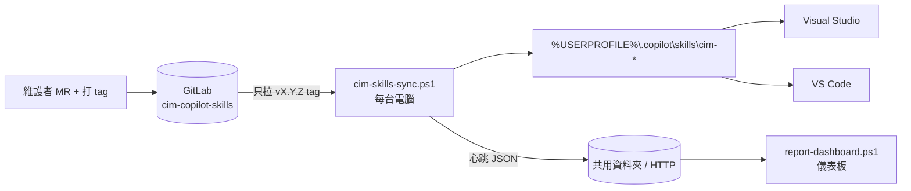

# Copilot Skills 課級共用與集中管理機制

### 研究規劃、架構設計與 POC 實作手冊（CIM 課）

> 文件版本：v1.0　撰寫日期：2026-10-12
>
> 文件中的產品功能以撰寫當下的官方文件為準。GitHub Copilot 更新很快，正式導入前請再確認一次第 3 章的技術事實。
> 第 9 章的 POC 程式碼已在模擬環境中測試通過（見 11.3），但還沒有在公司 Windows 電腦上實測，第一週請先完成 10.4 的實機驗證。

---

## 目錄

- [0. 這份文件怎麼用](#0-這份文件怎麼用)
- [1. 結論摘要](#1-結論摘要)
- [2. 背景知識：Agent Skills](#2-背景知識agent-skills)
- [3. 技術調查結論](#3-技術調查結論)
- [4. 管理方式比較](#4-管理方式比較)
- [5. 建議架構](#5-建議架構)
- [6. 共用 Repo 設計與治理](#6-共用-repo-設計與治理)
- [7. 同步機制細節](#7-同步機制細節)
- [8. 版本可視化：知道誰沒更新](#8-版本可視化知道誰沒更新)
- [9. POC 程式碼](#9-poc-程式碼)
- [10. POC 操作手冊](#10-poc-操作手冊)
- [11. 測試案例與驗收標準](#11-測試案例與驗收標準)
- [12. 時程規劃](#12-時程規劃)
- [13. 風險與對策](#13-風險與對策)
- [14. 維運與治理](#14-維運與治理)
- [15. 提報大綱與 Demo 腳本](#15-提報大綱與-demo-腳本)
- [16. FAQ](#16-faq)
- [附錄 A：待確認事項清單](#附錄-a待確認事項清單)
- [附錄 B：名詞對照](#附錄-b名詞對照)
- [附錄 C：參考資料](#附錄-c參考資料)

---

## 0. 這份文件怎麼用

| 你要做的事 | 看哪裡 |
|---|---|
| 寫研究報告 | 第 1～8 章，可直接改寫成報告內容 |
| 做 POC | 第 9 章複製程式碼，照第 10 章步驟操作，用第 11 章驗收 |
| 排時程、提報 | 第 12～15 章 |
| 第一週就要問清楚的事 | 附錄 A（問 IT、主管、課內同仁） |

文件中所有 `gitlab.example.local`、`\\fileserver\CIM\...`、`@cim/skills-maintainers` 都是範例值，請換成公司實際的位址與群組。

---

## 1. 結論摘要

| 研究問題 | 結論 |
|---|---|
| VS 和 VS Code 怎麼共用同一套 skill？ | 兩者都會讀使用者目錄 `%USERPROFILE%\.copilot\skills\`。這是唯一同時被兩個 IDE 支援、又跨所有專案的位置，所以架構以它為核心。 |
| 集中管理還是專案獨立管理？ | **混合分層**：課級共用的 skill 集中管理，同步到每個人的使用者目錄；只屬於某個專案的 skill 放在該專案 repo 的 `.github/skills/`。 |
| 內部 GitLab 怎麼用？ | 建一個共用 repo 當作唯一來源，用 tag（`v1.2.0`）發版，CI 自動檢查格式、命名與機密資訊。 |
| 怎麼自動同步？ | 每台電腦安裝一支 PowerShell 同步程式，由 Windows 工作排程器在登入後與每天自動執行，只安裝已發版的 tag。 |
| 怎麼知道誰的版本舊、誰沒更新？ | 同步程式每次執行都回報一份「心跳」（版本、同步狀態、IDE 版本、是否被本機修改）到共用資料夾或 HTTP 服務，再由儀表板列出每個人的狀態。 |
| 最大風險 | Visual Studio 2022 是否支援 skills、公司 PowerShell 執行原則、Copilot 組織政策是否關閉相關功能。 |

**一句話架構**：GitLab 發版 → 每台電腦自動同步到 `~/.copilot/skills` → 自動回報版本 → 儀表板看誰落後。



---

## 2. 背景知識：Agent Skills

### 2.1 Skill 是什麼

- 一個 skill 就是**一個資料夾**，裡面至少有一個 `SKILL.md`，可以再附帶腳本（`scripts/`）、參考文件（`references/`）、範本或資料（`assets/`）。
- 格式是開放標準（agentskills.io）。GitHub Copilot 在 VS Code、Visual Studio、Copilot CLI、Copilot cloud agent 都支援同一種格式，所以**一份 skill 可以跨工具使用**。
- Copilot 採**漸進式載入**，所以裝很多 skill 也不會塞爆對話內容：

| 階段 | 載入什麼 | 大約大小 |
|---|---|---|
| 啟動時 | 所有 skill 的 `name` 和 `description` | 每個約 100 tokens |
| Agent 判斷這個 skill 和目前任務有關時 | 整份 `SKILL.md` 內容 | 建議 5000 tokens 以內 |
| 執行過程需要時 | `scripts/`、`references/`、`assets/` 裡的檔案 | 用到才讀 |

**實務意義**：`description` 寫得好不好，直接決定 skill 會不會被用到。它要說清楚「做什麼」和「什麼時候用」，並包含使用者可能會講的關鍵字。

### 2.2 SKILL.md 格式

`SKILL.md` 必須以 YAML frontmatter 開頭，後面接 Markdown 說明。

| 欄位 | 必填 | 限制 |
|---|---|---|
| `name` | 是 | 最多 64 字元；只能用小寫英文、數字、連字號；不能以連字號開頭或結尾；不能有連續兩個連字號；**必須和資料夾名稱相同** |
| `description` | 是 | 1～1024 字元；說明做什麼、什麼時候用 |
| `license` | 否 | 授權名稱或授權檔案 |
| `compatibility` | 否 | 1～500 字元；只有在需要特定環境時才寫 |
| `metadata` | 否 | 自訂的 key-value，值必須是字串（例如版本號要寫成 `"1.0"`） |
| `allowed-tools` | 否 | 實驗性欄位，各工具支援程度不同 |

最小範例：

```markdown
---
name: cim-commit-message
description: 依 CIM 課規範撰寫 Git commit message。當使用者要寫 commit message 或準備提交程式碼時使用。Keywords - commit message, git commit, 提交訊息.
metadata:
  owner: "CIM Skills Maintainers"
---

# Commit Message 規範
（步驟、格式、範例……）
```

撰寫重點：

- 主檔 `SKILL.md` 控制在 500 行以內，細節搬到 `references/`，並用相對路徑連結（只往下一層，不要層層連結）。
- `description` 裡如果要寫「Keywords:」這類有冒號加空白的文字，YAML 會解析錯誤，請改用「Keywords -」或整段加引號。

### 2.3 和其他 Copilot 客製化方式的差別

| 方式 | 檔案 | 什麼時候生效 | 適合放什麼 |
|---|---|---|---|
| Custom instructions | `.github/copilot-instructions.md` | 每次對話都載入 | 全專案通用、簡短的規則 |
| Prompt files | `*.prompt.md` | 使用者用 `/` 指令手動叫用 | 固定流程的提示範本 |
| Custom agents | `*.agent.md` | 使用者選擇該 agent | 角色設定加上工具組合 |
| **Agent skills** | `skills/<name>/SKILL.md` | **Agent 判斷相關時自動載入** | 特定任務的步驟、規範、腳本 |

本研究只處理 skills。各 IDE 對其他類型的支援程度不同，但同一套「GitLab 發版 + 同步」的機制，未來可以擴充到其他類型。

### 2.4 Copilot 會從哪裡讀 skill

| 層級 | VS Code | Visual Studio 2026 |
|---|---|---|
| 專案層級（跟著 repo） | `.github/skills/`、`.claude/skills/`、`.agents/skills/` | 相同（VS 稱為 solution skills） |
| **個人層級（跟著使用者，跨所有專案）** | **`~/.copilot/skills/`**、`~/.claude/skills/`、`~/.agents/skills/` | **相同** |
| 額外指定路徑 | 設定 `chat.agentSkillsLocations` | 官方文件未提供 |
| 查看已載入的 skill | Chat 輸入 `/skills`；或齒輪 → Agent Customizations → Skills 分頁 | Copilot Chat 右下角 Tools 圖示 → Skills panel（目前只在 VS 2026 Insiders 18.6 以上） |

在 Windows 上，`~` 就是 `%USERPROFILE%`，例如 `C:\Users\a1001\.copilot\skills\`。

---

## 3. 技術調查結論

以下是會直接影響架構的事實，以及它代表的意義。

| # | 事實 | 對架構的影響 |
|---|---|---|
| F1 | VS Code 和 Visual Studio 都會讀個人層級的 `~/.copilot/skills/` | 這是兩個 IDE、所有專案的唯一交集 → **以它作為共用 skill 的安裝位置** |
| F2 | VS Code 可以用 `chat.agentSkillsLocations` 指定額外路徑，Visual Studio 文件沒有對應設定 | 不能靠「設定指向共用資料夾」解決，**必須把檔案實際放進 `~/.copilot/skills/`** |
| F3 | 目前沒有官方的組織層級 skill 派送機制；Visual Studio 團隊表示要等 GitHub 支援 org-level skills 後才會評估。而且我們用的是內部 GitLab | 派送與版本管理**必須自建** |
| F4 | VS Code 的 Agent Plugins 可以把 Git repo 當成 plugin 市集，但目前是預覽功能、開關由組織層級管理，Visual Studio 不支援 | 不適合當主方案，列為**持續觀察** |
| F5 | Skill 可以附帶腳本，Agent 可能會執行它 | 共用 skill 等於**發佈程式碼到每台電腦**，必須有審核流程 |
| F6 | Visual Studio 的 Skills panel 目前只在 Insiders 版 | 一般版 VS 使用者需用「對話觸發測試」驗證 skill 是否被讀到 |
| F7 | 官方文件沒寫清楚、POC 必須實測的項目：VS 2022 是否支援；專案層級和個人層級同名時誰優先；新增或修改 skill 後是否要重開 IDE；符號連結或網路路徑能不能被讀取 | 列入第 10.4 節的實機驗證 |

---

## 4. 管理方式比較

### 4.1 五種候選方案

#### 方案 A：專案獨立管理

- **做法**：每個專案 repo 自己放 `.github/skills/`。
- **優點**：跟程式碼一起版控、一起 review；clone 下來就能用；不需要任何額外工具；官方完整支援。
- **缺點**：同一份規範要複製到 N 個專案；改一次要改 N 個 repo；時間一久各專案版本不同（drift）；無法知道誰用哪一版。
- **結論**：適合「只屬於某個專案」的 skill，不適合課級共用規範。

#### 方案 B：集中管理 + 同步到使用者目錄（推薦）

- **做法**：GitLab 一個共用 repo，每台電腦的同步程式把 skill 複製到 `~/.copilot/skills/`。
- **優點**：改一次全課生效；兩個 IDE、所有專案都能用；版本一致；可以回報版本、知道誰落後；可以分 stable / beta 頻道、可以回滾。
- **缺點**：要自建同步與回報機制；每人要安裝一次；skill 版本不跟著專案程式碼版本走。
- **結論**：最符合本任務的四個研究方向，作為主方案。

#### 方案 C：Git submodule / subtree 嵌入各專案

- **做法**：共用 repo 以 submodule 掛到每個專案的 `.github/skills/` 底下。
- **優點**：每個專案可以鎖定版本，跟程式碼版本綁定。
- **缺點**：submodule 操作容易出錯；每個專案要自己更新版本；不在任何專案中的工作就用不到；仍然無法知道每個人的狀態。
- **結論**：管理成本高，不建議。

#### 方案 D：VS Code Agent Plugins 市集

- **做法**：把共用 repo 做成 plugin 市集，在 VS Code 設定 `chat.plugins.marketplaces`。
- **優點**：有原生的安裝、更新介面。
- **缺點**：預覽功能，行為可能變動；Visual Studio 不支援；設定可能被組織政策關閉；內部 GitLab 網址能否使用需要驗證；看不到每個人的版本。
- **結論**：持續觀察。如果日後 Visual Studio 也支援、且轉為正式功能，可以重新評估。

#### 方案 E：網路磁碟 + 符號連結

- **做法**：skill 放在網路共用資料夾，每個人在 `~/.copilot/skills/` 建立指向它的符號連結。
- **優點**：改了立即生效，不需要同步程式。
- **缺點**：Windows 建立指向網路路徑的符號連結需要管理員權限或開發人員模式（目錄連接 junction 不支援網路路徑）；網路斷線或在家時 skill 就消失；IDE 能否正確掃描網路路徑需要驗證；所有人永遠同一版，不能試用、不能個別回滾；任何有寫入權限的人改錯都會立即影響全課；不知道誰有沒有連上。
- **結論**：不建議。

### 4.2 評分比較

| 評估項目 | A 專案獨立 | **B 集中+同步** | C submodule | D Plugin 市集 | E 網路磁碟 |
|---|---|---|---|---|---|
| 同時支援 VS 與 VS Code | ✓ | **✓** | ✓ | ✗ | △ 待驗證 |
| 跨專案共用 | ✗ | **✓** | △ 每專案要加 | ✓ | ✓ |
| 改一次全課生效 | ✗ | **✓** | ✗ | ✓ | ✓ |
| 版本一致性 | ✗ | **✓** | △ | △ | ✓ |
| 知道誰用哪一版、誰沒更新 | ✗ | **✓ 心跳回報** | ✗ | ✗ | ✗ |
| 試用頻道、可回滾 | △ | **✓** | ✓ | △ | ✗ |
| 離線可用 | ✓ | **✓** | ✓ | ✓ | ✗ |
| 導入門檻 | 低 | **中（每人裝一次）** | 高 | 中 | 中（需權限） |
| 官方支援程度 | 正式 | **正式（只用標準路徑）** | 正式 | 預覽 | 未知 |
| 跟程式碼版本綁定 | ✓ | ✗ | ✓ | ✗ | ✗ |

### 4.3 建議：B 為主、A 為輔的分層架構

| 層級 | 放在哪裡 | 誰維護 | 範例 |
|---|---|---|---|
| **課級共用** | GitLab `cim-copilot-skills` → 同步到 `~/.copilot/skills/cim-*` | Skills 維護小組 | 程式撰寫規範、commit 規範、code review 清單、課內共用框架用法 |
| **專案專屬** | 專案 repo 的 `.github/skills/` | 專案成員 | 這個系統的部署步驟、特定設備協定細節 |
| **個人** | `~/.copilot/skills/`，名稱**不加** `cim-` 前綴 | 個人 | 個人習慣、試驗中的 skill |

新 skill 要放哪裡的判斷方式：

1. 只跟某一個專案有關 → 放專案的 `.github/skills/`。
2. 兩個以上專案、或全課都會用到 → 發 MR 到共用 repo。
3. 還在試驗 → 先放個人目錄（不加 `cim-` 前綴），用得順再發 MR 進共用 repo。

避免同名衝突的規則：共用 skill 一律 `cim-` 開頭；專案 skill 和個人 skill 不使用 `cim-` 開頭。

---

## 5. 建議架構

### 5.1 全貌

```
┌──────────────────────────── 內部 GitLab ────────────────────────────┐
│  cim/cim-copilot-skills（唯一來源）                                  │
│   ├─ skills/cim-*/SKILL.md  …  每個 skill 一個資料夾                 │
│   ├─ tools/                 …  同步、安裝、儀表板、lint 工具          │
│   ├─ VERSION / CHANGELOG.md                                          │
│   └─ CI：MR 時檢查格式 → 維護者打 tag vX.Y.Z → 驗證版本號             │
└───────────────────────────────┬──────────────────────────────────────┘
                                │ git fetch（只安裝 vX.Y.Z tag）
┌───────────────────────────────▼──────────── 每位工程師的電腦 ─────────┐
│  工作排程器：登入後 2 分鐘 + 每天 09:30（隨機延遲 0～30 分）           │
│        │                                                              │
│  %USERPROFILE%\.cim-skills\bin\cim-skills-sync.ps1                    │
│   1. 取得最新 tag    2. 比對內容 hash    3. 新增 / 更新 / 移除 skill   │
│   4. 本機被改過 → 備份後還原    5. 寫 state.json    6. 回報心跳        │
│        │                                                              │
│  %USERPROFILE%\.copilot\skills\cim-*  ──►  Visual Studio / VS Code     │
└───────────────────────────────┬──────────────────────────────────────┘
                                │ 心跳 JSON（帳號、電腦、版本、狀態、IDE 版本）
┌───────────────────────────────▼──────────────────────────────────────┐
│  \\fileserver\CIM\copilot-skills-status\  或  heartbeat_server.py      │
│        │                                                              │
│  report-dashboard.ps1（每天排程）→ _dashboard.html / CSV               │
│   最新 / 落後 / 同步失敗 / 未安裝 / 太久沒回報 / 本機有修改             │
└──────────────────────────────────────────────────────────────────────┘
```

### 5.2 元件說明

| 元件 | 位置 | 說明 |
|---|---|---|
| 共用 repo `cim-copilot-skills` | GitLab | 所有共用 skill 與工具的唯一來源 |
| GitLab CI | GitLab | MR 時檢查 skill 格式與機密；打 tag 時檢查版本號，產出 skill 目錄清單 |
| `cim-skills-sync.ps1` | 每台電腦 `%USERPROFILE%\.cim-skills\bin\` | 同步主程式 |
| `install.ps1` / `uninstall.ps1` | repo 的 `tools/` | 一次性安裝與移除 |
| 工作排程器工作「CIM Copilot Skills Sync」 | 每台電腦 | 自動執行同步，不需要系統管理員權限 |
| 心跳收集 | 共用資料夾，或 `heartbeat_server.py` | 每台電腦一個 JSON 檔 |
| `report-dashboard.ps1` | 維護者電腦或伺服器（排程） | 產生 HTML 儀表板與 CSV |
| `lint_skills.py` | CI 與本機 | 檢查 skill 是否符合規格與課內規則 |

### 5.3 每台電腦上的目錄

```
%USERPROFILE%\
├─ .copilot\skills\                 ← VS 與 VS Code 都會讀這裡
│  ├─ cim-code-review\              ← 同步程式管理（cim- 前綴）
│  ├─ cim-commit-message\
│  ├─ cim-csharp-coding-standard\
│  └─ my-notes\                     ← 個人 skill，同步程式不會碰
└─ .cim-skills\                     ← 同步程式自己的資料
   ├─ bin\          cim-skills-sync.ps1、uninstall.ps1
   ├─ repo\         GitLab repo 的本機快取（git clone）
   ├─ backup\       被本機修改過的 skill 備份（保留最近 5 次）
   ├─ logs\         每日執行記錄 sync-yyyyMMdd.log（保留 14 天）
   ├─ staging\      安裝過程的暫存區
   ├─ config.json   設定
   └─ state.json    目前安裝的版本，以及每個 skill 的內容 hash
```

### 5.4 設計決策與理由

| # | 決策 | 理由 |
|---|---|---|
| D1 | 只使用標準路徑 `~/.copilot/skills/` | 兩個 IDE 都正式支援，不依賴預覽功能或 IDE 專屬設定 |
| D2 | 以整個 repo 為發版單位，只有一個版本號 | 「誰落後」只要比一個版本號；單一 skill 的版本可寫在 `metadata` 供參考 |
| D3 | stable 頻道只安裝 tag，不安裝 main | 未審核或試用中的內容不會跑到全課電腦；main 留給 beta 頻道試用 |
| D4 | 用「複製」安裝，不直接 clone 到 skills 目錄、也不用符號連結 | 每個 skill 必須是 skills 底下的一層資料夾；複製後可用 hash 偵測本機修改；不需要特殊權限 |
| D5 | `cim-` 前綴 + `state.json` 只管理自己裝的 skill | 個人 skill 可以安全共存，同步程式不會誤刪 |
| D6 | 本機被修改 → 先備份、再還原官方版本、回報 | 保證全課一致；想客製請改名成個人 skill 或發 MR |
| D7 | 全課回滾用「發一個新的修正版」；個人回滾用 `pinnedVersion` | 不需要刪除 tag，歷史紀錄清楚；個人可以暫時停在舊版排查問題 |
| D8 | 使用 Windows PowerShell 5.1 相容語法，程式碼只用 ASCII 字元 | Windows 內建、免安裝；避免 5.1 讀取無 BOM 檔案時中文亂碼 |
| D9 | 心跳由電腦主動回報（push） | GitLab 只看得到存取紀錄，看不到本機實際版本、同步失敗、本機修改、IDE 版本 |
| D10 | 背景執行時關閉 git 的登入提示 | 避免排程工作卡在看不到的登入視窗；第一次安裝時才允許互動登入 |
| D11 | 同步程式會自我更新 | 工具本身跟著 tag 發版，修 bug 不需要每個人重新安裝 |

### 5.5 同步流程

1. **取得鎖**：同一台電腦同時只會有一個同步在跑（例如登入觸發和每日觸發撞在一起）。
2. **讀取** `config.json` 與 `state.json`。
3. **git fetch**。失敗時保留目前安裝的版本、回報 `fetch_failed`，以結束代碼 2 結束。
4. **決定目標版本**：`-Version` 參數 → `pinnedVersion` 設定 → beta 頻道（main 分支）→ 最新的 `vX.Y.Z` tag。
5. **checkout** 目標 commit。
6. **比對與安裝**：
   - 上游已刪除或改名的 skill → 移除（若本機改過，先備份）。
   - 新的 skill → 新增。
   - 內容 hash 不同 → 更新。
   - 內容相同 → 不動。
   - 本機被改過、或已有同名但不是同步程式安裝的資料夾 → 先備份再覆蓋。
7. **寫入** `state.json`（版本、commit、每個 skill 的 hash）。
8. **自我更新**：如果 repo 中的同步程式比本機新，替換 `bin\` 裡的檔案（下次執行生效）。
9. **清理**舊的備份與日誌。
10. **回報心跳**到共用資料夾和／或 HTTP 服務（失敗只記錄警告，不影響同步結果）。

結束代碼：

| 代碼 | 意義 |
|---|---|
| 0 | 成功（包含「已是最新」與「另一個同步正在執行」） |
| 1 | 錯誤（例如設定檔不存在、找不到 tag） |
| 2 | 連不上 GitLab，保留目前安裝的版本 |

### 5.6 各種情境的處理方式

| 情境 | 同步程式的行為 | 心跳中看得到 |
|---|---|---|
| 第一次安裝 | clone repo，安裝全部 skill | `changes: added ...` |
| 沒有新版 | 不做任何變更 | 日誌：Already up to date |
| 有新版 | 只更新有變動的 skill | `changes: updated ...` |
| 有人在本機改了共用 skill | 備份到 `backup\時間戳\`，還原官方版本 | `localModified` |
| 上游刪除或改名 skill | 移除舊的（改過的先備份） | `changes: removed ...` |
| 已有同名資料夾，但不是同步程式裝的 | 備份後覆蓋 | `localModified` |
| 連不上 GitLab | 保留現有版本 | `status: fetch_failed` |
| 同時執行兩次 | 第二個直接結束 | — |
| 個人 skill（沒有 `cim-` 前綴） | 完全不碰 | — |
| 用 `-Version v1.0.0` 執行 | 這一次安裝指定版本，下次排程回到最新版 | `version` |
| `config.json` 設定 `pinnedVersion` | 一直停在指定版本 | `pinned: true` |
| 同步程式本身有新版 | 自動替換 `bin\` 中的腳本 | 日誌：Self-update |

---

## 6. 共用 Repo 設計與治理

### 6.1 目錄結構

```
cim-copilot-skills/
├─ skills/
│  ├─ cim-csharp-coding-standard/
│  │  └─ SKILL.md
│  ├─ cim-commit-message/
│  │  └─ SKILL.md
│  └─ cim-code-review/
│     ├─ SKILL.md
│     └─ references/
│        └─ checklist.md
│  └─ （v1.1.0 另收錄 10 個公開 skill，見 THIRD_PARTY_NOTICES.md）
├─ tools/
│  ├─ cim-skills-sync.ps1        同步主程式
│  ├─ install.ps1                安裝（每人一次）
│  ├─ uninstall.ps1              移除
│  ├─ report-dashboard.ps1       儀表板
│  ├─ lint_skills.py             格式檢查（CI 與本機）
│  ├─ heartbeat_server.py        （選用）HTTP 心跳接收服務
│  ├─ config.example.json        設定範例
│  └─ members.example.csv        成員名單範例
├─ .gitlab/
│  ├─ CODEOWNERS
│  └─ merge_request_templates/Skill.md
├─ .gitlab-ci.yml
├─ VERSION                       例：1.0.0
├─ CHANGELOG.md
├─ THIRD_PARTY_NOTICES.md      外部 skill 的授權與來源
└─ README.md
```

### 6.2 命名規則

- 共用 skill：`cim-<領域>-<用途>`，例如 `cim-csharp-coding-standard`、`cim-eap-troubleshooting`。
- 只能用小寫英文、數字和單一連字號，最長 64 字元，必須和資料夾同名。
- 專案 skill：不要用 `cim-` 開頭，建議用 `<專案代號>-<用途>`。

### 6.3 Skill 撰寫規範

- **description**：寫清楚「做什麼」+「什麼時候用」+ 關鍵字。課內提問常常中英混用，關鍵字中英文都放。
- **長度**：`SKILL.md` 控制在 500 行以內，細節放 `references/`。
- **內容**：用步驟寫；附範例；寫清楚「不要做什麼」（例如：單號不可自行編造）。
- **機密**：不放帳號密碼、token、連線字串、內部 IP、客戶或產品機密。
- **腳本**：`scripts/` 中的程式要說明用途與相依套件，盡量只做讀取或明確的動作；審核者必須看得懂它會做什麼。
- **負責人**：在 `metadata.owner` 寫明誰維護。

### 6.4 版本規則（SemVer）

| 變更 | 版本號 | 例子 |
|---|---|---|
| 刪除或改名 skill、行為有不相容的大改 | MAJOR：`1.4.2 → 2.0.0` | 把 `cim-commit-message` 改名成 `cim-git-commit` |
| 新增 skill、既有 skill 新增能力 | MINOR：`1.4.2 → 1.5.0` | 新增 `cim-sql-review` |
| 修正文字、修正錯誤 | PATCH：`1.4.2 → 1.4.3` | 修正範例中的錯字 |

### 6.5 發版流程

1. 開分支、修改 skill，在自己的 IDE 實際觸發測試（可以先把資料夾複製到個人 skills 目錄、改成非 `cim-` 名稱測試）。
2. 發 MR（使用 MR 範本），CI 檢查通過，由 CODEOWNERS 審核。
3. 合併到 main → 設定為 beta 頻道的人（維護者、自願試用者）下次同步就會拿到。
4. 試用 1～3 天沒有問題 → 維護者更新 `VERSION` 與 `CHANGELOG.md`，打 tag `vX.Y.Z` 並推送。
5. tag pipeline 驗證版本號 → 全課下次同步時自動更新。
6. 在課內頻道公告這版的變更重點。

### 6.6 GitLab 設定建議

選單位置會因 GitLab 版本不同而略有差異。

| 設定 | 建議 |
|---|---|
| 專案可見度 | Internal 或 Private |
| 成員權限 | 全課：Reporter（可讀，足夠同步）；貢獻者：Developer（可開分支、發 MR）；維護小組：Maintainer |
| Protected branch `main` | 只能透過 MR 合併；Allowed to push：No one；Allowed to merge：Maintainers |
| Protected tags `v*` | 只有 Maintainers 可以建立 |
| Merge request | 勾選「Pipelines must succeed」 |
| Code Owners 強制核准 | 需要 GitLab Premium 以上；Free 版可以用「只有 Maintainer 能合併」替代 |

### 6.7 CI 自動檢查項目

`tools/lint_skills.py` 在 MR、main、tag 三種 pipeline 都會執行：

| 類型 | 檢查項目 | 等級 |
|---|---|---|
| 規格 | `SKILL.md` 存在、frontmatter 格式正確 | 錯誤 |
| 規格 | `name` 格式、長度、和資料夾同名 | 錯誤 |
| 規格 | `description` 必填、長度 ≤ 1024 | 錯誤 |
| 規格 | `compatibility` 長度、`metadata` 值必須是字串 | 錯誤 |
| 課內規則 | 名稱必須以 `cim-` 開頭 | 錯誤 |
| 課內規則 | 必須有 `metadata.owner` | 警告 |
| 品質 | description 太短；`SKILL.md` 超過 500 行 | 警告 |
| 品質 | `SKILL.md` 內的相對連結指向不存在的檔案 | 錯誤 |
| 資安 | 疑似 GitLab token、私鑰、密碼、含密碼的連線字串 | 錯誤 |
| 資安 | 內部 IP 位址 | 警告 |
| 資安 | `scripts/` 中有檔案 → 提醒審核者檢查 | 資訊 |
| 發版 | `VERSION` 是合法版本號；`CHANGELOG.md` 有對應段落；tag 等於 `v` + VERSION | 錯誤 |

---

## 7. 同步機制細節

### 7.1 觸發時機

| 觸發 | 說明 |
|---|---|
| 登入後 2 分鐘 | 等 VPN 與網路就緒 |
| 每天 09:30，隨機延遲 0～30 分鐘 | 避免全課同一秒打 GitLab |
| 錯過排程時間 | 開機後補跑（StartWhenAvailable） |
| 手動 | 隨時可以執行 `cim-skills-sync.ps1` |
| 公司不允許「登入時」觸發 | 安裝程式會自動改用「每日排程 + 啟動資料夾捷徑」 |

### 7.2 發行頻道

| 頻道 | 安裝內容 | 適用對象 | 設定方式 |
|---|---|---|---|
| `stable`（預設） | 最新的 `vX.Y.Z` tag | 全課 | `"channel": "stable"` |
| `beta` | main 分支最新內容 | 維護者、自願試用者 | `"channel": "beta"` |
| 釘選 | 指定的 tag | 排查問題時暫時使用 | `"pinnedVersion": "v1.2.0"` |

### 7.3 GitLab 認證方式

| 方式 | 做法 | 優點 | 缺點 | 建議 |
|---|---|---|---|---|
| **個人帳號 + Git Credential Manager** | 第一次安裝時互動登入，GCM 把憑證存進 Windows 認證管理員（Git for Windows 內建 GCM） | 不需要共用密碼；權限跟著人走，離職自動失效 | 每人第一次要登入；密碼或 token 過期要重新登入 | **POC 與正式導入都建議** |
| Group Deploy Token（read_repository） | 把 token 寫在 repoUrl：`https://<名稱>:<token>@gitlab...` | 不需要個人登入 | token 以明文存在每台電腦；外洩要全部更換 | 只有 GCM 不可行時才用 |
| SSH key | 每人設定 SSH key，repoUrl 用 `git@gitlab...` | 很多人已經設定好 | 有 passphrase 時，背景排程可能無法使用 | 課內普遍使用 SSH 時可考慮 |

背景執行時，同步程式會設定 `GIT_TERMINAL_PROMPT=0` 與 `GCM_INTERACTIVE=never`，憑證失效時會直接失敗並回報，而不是卡在看不到的登入視窗。重新登入方式：手動執行一次 `cim-skills-sync.ps1 -Interactive`。

### 7.4 公司網路環境注意事項

- **公司內部憑證**：如果 git 出現 SSL certificate problem，執行 `git config --global http.sslBackend schannel`，讓 Git 使用 Windows 的憑證存放區。
- **Proxy**：內部 GitLab 通常不走 proxy。如果全域設定了 `http.proxy`，可以針對內部網址取消：`git config --global http.https://gitlab.example.local/.proxy ""`。
- **PowerShell 執行原則**：排程指令已帶 `-ExecutionPolicy Bypass`。但如果公司用群組原則（GPO）強制執行原則，Bypass 會無效，需要請 IT 對腳本簽章或加入白名單。
- **防毒 / EDR**：背景執行 PowerShell 可能被資安軟體標記，導入前先跟 IT 報備。

### 7.5 檔案編碼規則

- `.ps1` 全部只用 ASCII 字元。如果要加中文，請用「UTF-8 with BOM」存檔，否則 Windows PowerShell 5.1 會讀成亂碼。
- JSON 用 UTF-8（無 BOM）寫入；讀取時有無 BOM 都可以。
- 儀表板輸出的 CSV 使用 UTF-8 with BOM，Excel 打開中文姓名才不會亂碼。
- `SKILL.md` 用 UTF-8，中文沒問題。

### 7.6 Mac / Linux（如有需要）

同步程式也可以在 PowerShell 7（`pwsh`）上執行，安裝程式會略過工作排程器，改用 cron：

```bash
# 每天 09:30 同步
30 9 * * * pwsh -NoProfile -File "$HOME/.cim-skills/bin/cim-skills-sync.ps1" -Quiet
```

---

## 8. 版本可視化：知道誰沒更新

### 8.1 為什麼要由電腦主動回報

GitLab 只看得到誰在什麼時候存取了 repo，看不到：

- 每台電腦**實際安裝**的是哪一版
- 同步是否失敗、失敗原因
- 有沒有人在本機修改了共用 skill
- 每個人的 VS Code、Copilot Chat、Visual Studio 版本（排查 skill 不生效時很有用）
- 誰**根本沒有安裝**

所以每次同步結束時，同步程式都會寫一份「心跳」。再搭配一份全課成員名單，就能找出沒有安裝的人。

### 8.2 心跳內容

| 欄位 | 說明 |
|---|---|
| `user`、`domain`、`host` | Windows 帳號、網域、電腦名稱 |
| `status` | `ok`、`fetch_failed`（連不上 GitLab）、`error`、`uninstalled` |
| `message` | 失敗原因 |
| `version`、`commit`、`channel`、`pinned` | 目前安裝的版本與頻道 |
| `installedSkills` | 目前安裝的共用 skill |
| `localModified` | 這次被發現本機修改過、已備份並還原的 skill |
| `changes` | 這次同步新增、更新、移除了哪些 skill |
| `installedAt` | 最後一次實際變更安裝內容的時間 |
| `lastCheckAt` | 最後一次成功連上 GitLab 檢查的時間 |
| `reportedAt` | 這份心跳的時間 |
| `scriptVersion`、`psVersion`、`os` | 同步程式、PowerShell、作業系統版本 |
| `ide.vscode`、`ide.copilotChat`、`ide.visualStudio` | IDE 與 Copilot Chat 擴充套件版本 |

實際產出的範例（測試環境，所以沒有 IDE 資訊）：

```json
{
  "schema": 1,
  "user": "a1001",
  "domain": "CORP",
  "host": "CIM-PC-023",
  "status": "ok",
  "message": "",
  "version": "v2.0.0",
  "commit": "4469985dd31fcbac366bd607b09680855d37c8da",
  "channel": "stable",
  "pinned": false,
  "installedSkills": ["cim-code-review", "cim-csharp-coding-standard", "cim-git-commit", "cim-new-skill"],
  "localModified": [],
  "changes": ["added cim-code-review", "added cim-csharp-coding-standard", "added cim-git-commit", "added cim-new-skill"],
  "installedAt": "2026-10-12T22:47:20.6617906+08:00",
  "lastCheckAt": "2026-10-12T22:47:20.6617906+08:00",
  "reportedAt": "2026-10-12T22:47:20.7227259+08:00",
  "scriptVersion": "1.0.0",
  "psVersion": "5.1.19041.4648",
  "os": "Microsoft Windows NT 10.0.19045.0",
  "ide": { "vscode": "1.105.0", "copilotChat": "0.32.0", "visualStudio": ["Visual Studio Professional 2026 (18.6.0)"] }
}
```

（帳號、電腦名稱、IDE 版本是示意值。）

### 8.3 收集方式

|  | 共用資料夾（POC 建議） | HTTP 接收服務（正式導入建議） |
|---|---|---|
| 做法 | 每台電腦寫 `\\fileserver\CIM\copilot-skills-status\<帳號>@<電腦>.json` | `heartbeat_server.py` 接收 POST，存成**同樣格式**的 JSON |
| 需要 | 一個全課都能寫入的共用資料夾 | 一台內部機器 + Python 3（只用標準函式庫，不需要 pip） |
| 優點 | 零開發，POC 最快 | 使用者不需要共用資料夾的寫入權限；會記錄來源 IP |
| 缺點 | 每個人都能改到別人的檔案；共用資料夾連不到時就回報不了 | 要維護一個服務；目前沒有驗證機制，只能放在內網 |
| 設定 | `"reportDir": "\\\\fileserver\\CIM\\copilot-skills-status"` | `"reportUrl": "http://<伺服器>:8080/api/heartbeat"` |

兩種方式可以同時開啟，而且產出的檔案格式相同，儀表板程式不需要修改。

### 8.4 狀態判定規則

儀表板依下列順序判定每台電腦的狀態，越前面越需要處理：

| 優先 | 狀態 | 判定條件 | 處理方式 |
|---|---|---|---|
| 1 | Not installed | 在成員名單中，但沒有任何心跳 | 請他安裝 |
| 2 | Sync failed | 最後一次 `status` 不是 `ok` | 看 `message`；多半是 VPN 或憑證過期 |
| 3 | Outdated | 版本不是最新，而且沒有釘選 | 確認電腦有沒有開機、排程有沒有被停用 |
| 4 | Stale | 超過 N 天（預設 3 天）沒有心跳 | 可能休假或電腦沒開；連續一週以上再追 |
| 5 | Pinned | 刻意釘選在舊版 | 確認排查結束後解除 |
| 6 | Uninstalled | 用 `uninstall.ps1` 主動移除 | 確認是否有意移除 |
| 7 | Up to date | 最新版，而且最近有回報 | — |

另外，`LocalEdits` 欄位有值的人代表曾在本機修改共用 skill，可以了解他想改什麼，也許值得發 MR。

### 8.5 儀表板

`report-dashboard.ps1` 會產生：

- **HTML**：最上方顯示「完全最新的人數比例」與各狀態數量，下方表格依嚴重度排序，列出姓名、帳號、組別、電腦、版本、落後幾版、頻道、最後心跳、最後成功同步、本機修改、VS Code / Copilot Chat / Visual Studio 版本、訊息。
- **CSV**：同樣欄位，可用 Excel 篩選、寄給主管。
- **主控台摘要**，例如：`Latest v2.0.0: 2/6 people fully up to date; outdated=1, failed=1, not installed=1`

建議在維護者電腦或伺服器上每天排程執行一次，把 HTML 輸出到共用資料夾，主管直接打開就能看。

### 8.6 提醒落後的人

- 週會時打開儀表板。
- 狀態為 Not installed、Sync failed、Outdated 超過兩天的人，由維護者私訊提醒（用 CSV 篩選名單）。
- 進階：串接公司的郵件或通訊軟體機器人自動通知（依公司可用的服務實作）。

### 8.7 隱私說明

心跳只包含帳號、電腦名稱、skill 版本、IDE 版本與同步狀態，不包含任何程式碼、檔案內容或 Copilot 對話。導入前在課內說明收集的內容與用途，並確認主管或 IT 同意。

---

## 9. POC 程式碼

以下就是 POC 共用 repo 的完整內容。在 GitLab 建立 `cim-copilot-skills` 專案後，照第 6.1 節的目錄結構放好這些檔案即可。

| 檔案 | 用途 | 執行環境 |
|---|---|---|
| `tools/cim-skills-sync.ps1` | 同步主程式 | 每台電腦（Windows PowerShell 5.1 / PowerShell 7） |
| `tools/install.ps1` | 一次性安裝 | 每台電腦 |
| `tools/uninstall.ps1` | 移除 | 每台電腦 |
| `tools/report-dashboard.ps1` | 產生儀表板 | 維護者電腦或伺服器 |
| `tools/lint_skills.py` | skill 格式檢查 | GitLab CI、本機（Python 3.8 以上，只用標準函式庫） |
| `tools/heartbeat_server.py` | （選用）HTTP 心跳接收 | 內部伺服器（Python 3.8 以上，只用標準函式庫） |
| `tools/config.example.json` | 設定範例 | — |
| `tools/members.example.csv` | 成員名單範例 | — |
| `.gitlab-ci.yml` | CI 設定 | GitLab |
| `.gitlab/CODEOWNERS`、`.gitlab/merge_request_templates/Skill.md` | 審核設定、MR 範本 | GitLab |
| `VERSION`、`CHANGELOG.md`、`README.md` | 版本與說明 | — |
| `THIRD_PARTY_NOTICES.md` | 外部 skill 的授權、來源與修改紀錄 | — |
| `skills/...` | 三個範例 skill | — |

> **存檔注意**：`.ps1` 檔案都只用 ASCII 字元，用任何編輯器存檔都可以。如果之後要在 `.ps1` 裡加中文，請存成「UTF-8 with BOM」。

### 9.1 設定檔 `config.json`

安裝後位於 `%USERPROFILE%\.cim-skills\config.json`，由 `install.ps1` 產生。

| 欄位 | 預設值 | 說明 |
|---|---|---|
| `repoUrl` | （必填） | 共用 repo 的 clone 網址 |
| `channel` | `stable` | `stable`：最新 tag；`beta`：main 分支 |
| `betaBranch` | `main` | beta 頻道使用的分支 |
| `pinnedVersion` | 空白 | 填入 tag（如 `v1.2.0`）就會一直停在該版本 |
| `skillsDir` | 空白 = `~/.copilot/skills` | 安裝位置，通常不用改 |
| `skillPrefix` | `cim-` | 只有這個前綴的資料夾會被同步程式管理 |
| `reportDir` | 空白 | 心跳寫入的共用資料夾（JSON 中反斜線要寫兩次） |
| `reportUrl` | 空白 | 心跳 POST 的網址 |
| `reportUseWindowsAuth` | `false` | HTTP 回報時是否使用 Windows 整合驗證 |
| `selfUpdate` | `true` | 是否自動更新同步程式本身 |
| `keepBackups` | `5` | 保留幾次本機修改的備份 |
| `keepLogDays` | `14` | 日誌保留天數 |

```json
{
  "repoUrl": "https://gitlab.example.local/cim/cim-copilot-skills.git",
  "channel": "stable",
  "betaBranch": "main",
  "pinnedVersion": "",
  "skillsDir": "",
  "skillPrefix": "cim-",
  "reportDir": "\\\\fileserver\\CIM\\copilot-skills-status",
  "reportUrl": "",
  "reportUseWindowsAuth": false,
  "selfUpdate": true,
  "keepBackups": 5,
  "keepLogDays": 14
}
```

### 9.2 同步主程式 `tools/cim-skills-sync.ps1`

常用指令：

```powershell
# 一般執行（排程就是這樣跑）
powershell -ExecutionPolicy Bypass -File "$env:USERPROFILE\.cim-skills\bin\cim-skills-sync.ps1"

# 憑證過期，允許跳出登入視窗
... cim-skills-sync.ps1 -Interactive

# 這一次安裝指定版本（下次排程會回到最新版）
... cim-skills-sync.ps1 -Version v1.2.0

# 這一次改用 beta 頻道
... cim-skills-sync.ps1 -Channel beta

# 全部重裝
... cim-skills-sync.ps1 -Force
```

```powershell
<#
.SYNOPSIS
    Sync the CIM team's shared Copilot Agent Skills from the internal GitLab
    repository into the user-level skills folder (~/.copilot/skills), which is
    read by both Visual Studio and VS Code.

.DESCRIPTION
    - Pulls the latest release tag (stable channel), a branch (beta channel),
      or a pinned version.
    - Copies every skills/<prefix>* folder into the user skills folder.
    - Only touches folders it manages (tracked in state.json). Personal skills
      without the team prefix are never touched.
    - Detects local edits to managed skills, backs them up, then restores the
      official version.
    - Removes managed skills that were deleted or renamed upstream.
    - Writes a heartbeat (version / status / IDE versions) to a shared folder
      and/or an HTTP endpoint so the team can see who is out of date.

    Works on Windows PowerShell 5.1 and PowerShell 7+.
    Keep this file ASCII-only: Windows PowerShell 5.1 reads BOM-less files as ANSI.

    Exit codes: 0 = OK, 1 = error, 2 = could not reach GitLab (kept current version)

.EXAMPLE
    .\cim-skills-sync.ps1                  # normal run (used by the scheduled task)
.EXAMPLE
    .\cim-skills-sync.ps1 -Version v1.2.0  # one-off install of a specific version
.EXAMPLE
    .\cim-skills-sync.ps1 -Force           # reinstall even if already up to date
#>
[CmdletBinding()]
param(
    # Install this tag once (e.g. v1.2.0). For a permanent pin use pinnedVersion in config.json.
    [string]$Version,
    # Overrides the channel in config.json for this run.
    [ValidateSet('stable', 'beta')]
    [string]$Channel,
    [string]$ConfigPath,
    # Reinstall all managed skills even if nothing changed.
    [switch]$Force,
    # Do not send a heartbeat.
    [switch]$NoReport,
    # Allow git / Git Credential Manager to prompt for credentials (first install only).
    [switch]$Interactive,
    # No console output (log file only). Used by the scheduled task.
    [switch]$Quiet
)

Set-StrictMode -Version 2.0
$ErrorActionPreference = 'Stop'

$ScriptVersion = '1.0.1'
$CimHome    = Join-Path $HOME '.cim-skills'
if (-not $ConfigPath) { $ConfigPath = Join-Path $CimHome 'config.json' }
$RepoDir    = Join-Path $CimHome 'repo'
$StatePath  = Join-Path $CimHome 'state.json'
$LogDir     = Join-Path $CimHome 'logs'
$BackupRoot = Join-Path $CimHome 'backup'
$StagingDir = Join-Path $CimHome 'staging'
$BinDir     = Join-Path $CimHome 'bin'
$LockPath   = Join-Path $CimHome 'sync.lock'
$Utf8NoBom  = New-Object System.Text.UTF8Encoding($false)
$script:LogFile = $null

# ---------------------------------------------------------------- helpers ---

function Write-SyncLog {
    param([string]$Message, [ValidateSet('INFO', 'WARN', 'ERROR')][string]$Level = 'INFO')
    $line = '{0} [{1}] {2}' -f (Get-Date).ToString('yyyy-MM-dd HH:mm:ss'), $Level, $Message
    if ($script:LogFile) {
        try { [System.IO.File]::AppendAllText($script:LogFile, $line + [Environment]::NewLine, $Utf8NoBom) } catch { }
    }
    if (-not $Quiet) {
        switch ($Level) {
            'WARN'  { Write-Host $line -ForegroundColor Yellow }
            'ERROR' { Write-Host $line -ForegroundColor Red }
            default { Write-Host $line }
        }
    }
}

# Read a property from a PSCustomObject / hashtable; empty strings count as "not set".
function Get-Prop {
    param($Object, [string]$Name, $Default = $null)
    if ($null -eq $Object) { return $Default }
    $value = $null
    if ($Object -is [System.Collections.IDictionary]) {
        if ($Object.Contains($Name)) { $value = $Object[$Name] }
    } else {
        $p = $Object.PSObject.Properties[$Name]
        if ($null -ne $p) { $value = $p.Value }
    }
    if ($null -eq $value) { return $Default }
    if ($value -is [string] -and $value -eq '') { return $Default }
    return $value
}

function Read-JsonFile {
    param([string]$Path)
    if (-not (Test-Path -LiteralPath $Path)) { return $null }
    $raw = [System.IO.File]::ReadAllText($Path)   # detects UTF-8 BOM automatically
    if ([string]::IsNullOrWhiteSpace($raw)) { return $null }
    return ($raw | ConvertFrom-Json)
}

function Write-JsonFile {
    param([string]$Path, $Object)
    $json = $Object | ConvertTo-Json -Depth 8
    $tmp = '{0}.{1}.tmp' -f $Path, ([guid]::NewGuid().ToString('N').Substring(0, 8))
    [System.IO.File]::WriteAllText($tmp, $json, $Utf8NoBom)
    Move-Item -LiteralPath $tmp -Destination $Path -Force
}

# PowerShell 7 turns ISO date strings into [datetime] when reading JSON; 5.1 does not.
function Format-Date {
    param($Value)
    if ($null -eq $Value) { return $null }
    if ($Value -is [datetime]) { return $Value.ToString('o') }
    return [string]$Value
}

# Run git without letting stderr progress output turn into terminating errors (PS 5.1 issue).
function Invoke-Git {
    param([Parameter(Mandatory = $true)][string[]]$Arguments, [switch]$AllowFail)
    $prev = $ErrorActionPreference
    $ErrorActionPreference = 'Continue'
    try {
        $output = @(& git @Arguments 2>&1 | ForEach-Object { "$_" })
        $code = $LASTEXITCODE
    } finally {
        $ErrorActionPreference = $prev
    }
    if ($code -ne 0 -and -not $AllowFail) {
        throw ('git {0} failed (exit {1}): {2}' -f ($Arguments -join ' '), $code, ($output -join ' | '))
    }
    return [pscustomobject]@{ Code = $code; Output = $output }
}

function Get-GitValue {
    param([string[]]$Arguments)
    $r = Invoke-Git -Arguments $Arguments
    return ($r.Output | Where-Object { $_ -and $_.Trim() } | Select-Object -First 1).Trim()
}

function Get-FullPath {
    param([string]$Path)
    return [System.IO.Path]::GetFullPath($Path).TrimEnd('\', '/')
}

# Stable content hash of a folder: relative paths + file SHA256, sorted ordinally.
function Get-FolderHash {
    param([string]$Path)
    if (-not (Test-Path -LiteralPath $Path)) { return $null }
    $root = Get-FullPath $Path
    $entries = New-Object System.Collections.Generic.List[string]
    foreach ($file in [System.IO.Directory]::GetFiles($root, '*', [System.IO.SearchOption]::AllDirectories)) {
        $rel = $file.Substring($root.Length).TrimStart('\', '/').Replace('\', '/')
        $hash = (Get-FileHash -LiteralPath $file -Algorithm SHA256).Hash
        $entries.Add($rel + ':' + $hash)
    }
    $arr = $entries.ToArray()
    [System.Array]::Sort($arr, [System.StringComparer]::Ordinal)
    $bytes = [System.Text.Encoding]::UTF8.GetBytes(($arr -join "`n"))
    $sha = [System.Security.Cryptography.SHA256]::Create()
    try {
        return (($sha.ComputeHash($bytes) | ForEach-Object { $_.ToString('x2') }) -join '')
    } finally {
        $sha.Dispose()
    }
}

# Copy a folder including hidden files (Copy-Item may skip them).
function Copy-Folder {
    param([string]$Source, [string]$Destination)
    $src = Get-FullPath $Source
    $dst = Get-FullPath $Destination
    [void][System.IO.Directory]::CreateDirectory($dst)
    foreach ($dir in [System.IO.Directory]::GetDirectories($src, '*', [System.IO.SearchOption]::AllDirectories)) {
        [void][System.IO.Directory]::CreateDirectory((Join-Path $dst $dir.Substring($src.Length).TrimStart('\', '/')))
    }
    foreach ($file in [System.IO.Directory]::GetFiles($src, '*', [System.IO.SearchOption]::AllDirectories)) {
        [System.IO.File]::Copy($file, (Join-Path $dst $file.Substring($src.Length).TrimStart('\', '/')), $true)
    }
}

function Remove-Folder {
    param([string]$Path)
    if (Test-Path -LiteralPath $Path) { Remove-Item -LiteralPath $Path -Recurse -Force }
}

function Get-SafeName {
    param([string]$Name)
    return ($Name -replace '[\\/:*?"<>|\s]', '_')
}

# Best effort: which IDE / Copilot versions are installed (for the dashboard).
function Get-IdeInfo {
    $info = [ordered]@{ vscode = $null; copilotChat = $null; visualStudio = @() }

    try {
        $roots = @()
        if ($env:LOCALAPPDATA) { $roots += Join-Path $env:LOCALAPPDATA 'Programs\Microsoft VS Code' }
        if ($env:ProgramFiles) { $roots += Join-Path $env:ProgramFiles 'Microsoft VS Code' }
        foreach ($root in $roots) {
            if (-not (Test-Path -LiteralPath $root)) { continue }
            $pkg = Join-Path $root 'resources\app\package.json'
            if (-not (Test-Path -LiteralPath $pkg)) {
                # newer layouts may keep resources in a versioned sub folder
                $found = Get-ChildItem -LiteralPath $root -Directory -ErrorAction SilentlyContinue |
                    ForEach-Object { Join-Path $_.FullName 'resources\app\package.json' } |
                    Where-Object { Test-Path -LiteralPath $_ } | Select-Object -First 1
                if ($found) { $pkg = $found }
            }
            if (Test-Path -LiteralPath $pkg) { $info.vscode = [string](Read-JsonFile $pkg).version; break }
        }
        if (-not $info.vscode -and (Get-Command code -ErrorAction SilentlyContinue)) {
            $first = @(& code --version 2>$null) | Select-Object -First 1
            if ($first) { $info.vscode = [string]$first }
        }
    } catch { }

    try {
        $extDir = Join-Path (Join-Path $HOME '.vscode') 'extensions'
        if (Test-Path -LiteralPath $extDir) {
            $best = $null
            foreach ($d in Get-ChildItem -LiteralPath $extDir -Directory -Filter 'github.copilot-chat-*' -ErrorAction SilentlyContinue) {
                if ($d.Name -match '^github\.copilot-chat-(\d+\.\d+\.\d+)') {
                    $v = [version]$Matches[1]
                    if ($null -eq $best -or $v -gt $best) { $best = $v }
                }
            }
            if ($best) { $info.copilotChat = $best.ToString() }
        }
    } catch { }

    try {
        $pf86 = [Environment]::GetEnvironmentVariable('ProgramFiles(x86)')
        if ($pf86) {
            $vswhere = Join-Path $pf86 'Microsoft Visual Studio\Installer\vswhere.exe'
            if (Test-Path -LiteralPath $vswhere) {
                $json = (& $vswhere -all -prerelease -format json -utf8) -join ''
                $list = @()
                foreach ($vs in @($json | ConvertFrom-Json)) {
                    $ver = Get-Prop (Get-Prop $vs 'catalog') 'productDisplayVersion' (Get-Prop $vs 'installationVersion')
                    $list += ('{0} ({1})' -f (Get-Prop $vs 'displayName' 'Visual Studio'), $ver)
                }
                $info.visualStudio = $list
            }
        }
    } catch { }

    return $info
}

function Send-Heartbeat {
    param($Config, $Report)
    $reportDir = Get-Prop $Config 'reportDir'
    $reportUrl = Get-Prop $Config 'reportUrl'
    if (-not $reportDir -and -not $reportUrl) { Write-SyncLog 'No reportDir/reportUrl configured; heartbeat skipped.'; return }

    if ($reportDir) {
        try {
            if (-not (Test-Path -LiteralPath $reportDir)) { throw "Report folder not reachable: $reportDir" }
            $file = Join-Path $reportDir ((Get-SafeName ('{0}@{1}' -f $Report.user, $Report.host)) + '.json')
            Write-JsonFile -Path $file -Object $Report
            Write-SyncLog "Heartbeat written to $file"
        } catch {
            Write-SyncLog "Heartbeat to folder failed: $($_.Exception.Message)" 'WARN'
        }
    }
    if ($reportUrl) {
        try {
            [Net.ServicePointManager]::SecurityProtocol = [Net.ServicePointManager]::SecurityProtocol -bor [Net.SecurityProtocolType]::Tls12
            $body = [System.Text.Encoding]::UTF8.GetBytes(($Report | ConvertTo-Json -Depth 8))
            $irm = @{ Uri = $reportUrl; Method = 'Post'; Body = $body; ContentType = 'application/json; charset=utf-8'; TimeoutSec = 10 }
            # Windows integrated auth only when the receiver needs it (and preferably over https)
            if ([bool](Get-Prop $Config 'reportUseWindowsAuth' $false)) { $irm.UseDefaultCredentials = $true }
            Invoke-RestMethod @irm | Out-Null
            Write-SyncLog "Heartbeat posted to $reportUrl"
        } catch {
            Write-SyncLog "Heartbeat to URL failed: $($_.Exception.Message)" 'WARN'
        }
    }
}

# Map of skill name -> hash from state.json (works for PSCustomObject and hashtable).
function Get-ManagedSkills {
    param($State)
    $map = @{}
    $skills = Get-Prop $State 'skills'
    if ($null -eq $skills) { return $map }
    if ($skills -is [System.Collections.IDictionary]) {
        foreach ($k in $skills.Keys) { $map[[string]$k] = [string]$skills[$k] }
    } else {
        foreach ($p in $skills.PSObject.Properties) { $map[$p.Name] = [string]$p.Value }
    }
    return $map
}

function Resolve-Target {
    param([string]$Pinned, [string]$ChannelName, [string]$BetaBranch)
    if ($Pinned) {
        $r = Invoke-Git -Arguments @('-C', $RepoDir, 'rev-parse', '--verify', '--quiet', "refs/tags/$Pinned^{commit}") -AllowFail
        if ($r.Code -ne 0) { throw "Version '$Pinned' was not found in the repository tags." }
        return [pscustomobject]@{ Label = $Pinned; Commit = $r.Output[0].Trim(); Pinned = $true }
    }
    if ($ChannelName -eq 'beta') {
        $sha = Get-GitValue @('-C', $RepoDir, 'rev-parse', '--verify', "refs/remotes/origin/$BetaBranch^{commit}")
        return [pscustomobject]@{ Label = ('{0}@{1}' -f $BetaBranch, $sha.Substring(0, 8)); Commit = $sha; Pinned = $false }
    }
    $bestTag = $null
    $bestVer = $null
    # No wildcard argument here: PowerShell 7 on Linux/macOS expands 'v*' against the current folder.
    foreach ($t in (Invoke-Git -Arguments @('-C', $RepoDir, 'tag', '--list')).Output) {
        $t = $t.Trim()
        if ($t -match '^v(\d+)\.(\d+)\.(\d+)$') {
            $v = New-Object System.Version ([int]$Matches[1]), ([int]$Matches[2]), ([int]$Matches[3])
            if ($null -eq $bestVer -or $v -gt $bestVer) { $bestVer = $v; $bestTag = $t }
        }
    }
    if (-not $bestTag) { throw 'No release tag (vX.Y.Z) found in the repository.' }
    $sha = Get-GitValue @('-C', $RepoDir, 'rev-parse', "refs/tags/$bestTag^{commit}")
    return [pscustomobject]@{ Label = $bestTag; Commit = $sha; Pinned = $false }
}

function Remove-OldItems {
    param($Config)
    try {
        $keepBackups = [int](Get-Prop $Config 'keepBackups' 5)
        if (Test-Path -LiteralPath $BackupRoot) {
            Get-ChildItem -LiteralPath $BackupRoot -Directory | Sort-Object Name -Descending |
                Select-Object -Skip $keepBackups | ForEach-Object { Remove-Folder $_.FullName }
        }
        $keepLogDays = [int](Get-Prop $Config 'keepLogDays' 14)
        $limit = (Get-Date).AddDays(-$keepLogDays)
        Get-ChildItem -LiteralPath $LogDir -File -Filter 'sync-*.log' |
            Where-Object { $_.LastWriteTime -lt $limit } | Remove-Item -Force
    } catch {
        Write-SyncLog "Cleanup failed: $($_.Exception.Message)" 'WARN'
    }
}

# ------------------------------------------------------------------- main ---

function Invoke-Sync {
    $config = Read-JsonFile $ConfigPath
    if ($null -eq $config) { throw "Config not found: $ConfigPath (run install.ps1 first)." }

    $repoUrl    = Get-Prop $config 'repoUrl'
    if (-not $repoUrl) { throw 'repoUrl is not set in config.json.' }
    $prefix     = Get-Prop $config 'skillPrefix' 'cim-'
    $skillsDir  = Get-Prop $config 'skillsDir' (Join-Path (Join-Path $HOME '.copilot') 'skills')
    $chan       = $Channel
    if (-not $chan) { $chan = Get-Prop $config 'channel' 'stable' }
    $betaBranch = Get-Prop $config 'betaBranch' 'main'
    $pinned     = $Version
    if (-not $pinned) { $pinned = Get-Prop $config 'pinnedVersion' }

    if (-not $Interactive) {
        # Never hang a hidden scheduled task on a credential prompt.
        $env:GIT_TERMINAL_PROMPT = '0'
        $env:GCM_INTERACTIVE = 'never'
    }

    $state   = Read-JsonFile $StatePath
    $managed = Get-ManagedSkills $state
    $result  = [ordered]@{ status = 'ok'; message = ''; localModified = @(); changes = @() }
    $exitCode = 0

    # 1. fetch ---------------------------------------------------------------
    $fetched = $false
    try {
        if (-not (Get-Command git -ErrorAction SilentlyContinue)) { throw 'git is not installed or not on PATH.' }
        if (-not (Test-Path -LiteralPath (Join-Path $RepoDir '.git'))) {
            Remove-Folder $RepoDir
            Write-SyncLog "Cloning $repoUrl"
            Invoke-Git -Arguments @('clone', '--quiet', '--no-checkout', $repoUrl, $RepoDir) | Out-Null
        } else {
            $currentUrl = Get-GitValue @('-C', $RepoDir, 'remote', 'get-url', 'origin')
            if ($currentUrl -ne $repoUrl) { Invoke-Git -Arguments @('-C', $RepoDir, 'remote', 'set-url', 'origin', $repoUrl) | Out-Null }
        }
        Invoke-Git -Arguments @('-C', $RepoDir, 'fetch', '--quiet', '--tags', '--prune', '--prune-tags', '--force', 'origin') | Out-Null
        $fetched = $true
    } catch {
        $result.status = 'fetch_failed'
        $result.message = $_.Exception.Message
        $exitCode = 2
        Write-SyncLog "Could not update from GitLab, keeping the installed version. $($_.Exception.Message)" 'WARN'
    }

    # 2. resolve + install ------------------------------------------------------
    $newState = $null
    if ($fetched) {
        $target = Resolve-Target -Pinned $pinned -ChannelName $chan -BetaBranch $betaBranch
        Write-SyncLog ('Target: {0} ({1}) channel={2}{3}' -f $target.Label, $target.Commit.Substring(0, 8), $chan, $(if ($target.Pinned) { ' [pinned]' } else { '' }))

        Invoke-Git -Arguments @('-C', $RepoDir, '-c', 'advice.detachedHead=false', 'checkout', '--quiet', '--force', $target.Commit) | Out-Null
        Invoke-Git -Arguments @('-C', $RepoDir, 'clean', '-fdxq') | Out-Null

        $srcRoot = Join-Path $RepoDir 'skills'
        if (-not (Test-Path -LiteralPath $srcRoot)) { throw "No 'skills' folder in repository at $($target.Label)." }
        $sources = @{}
        foreach ($d in Get-ChildItem -LiteralPath $srcRoot -Directory) {
            if (-not $d.Name.StartsWith($prefix)) { Write-SyncLog "Skipped '$($d.Name)': name must start with '$prefix'." 'WARN'; continue }
            if (-not (Test-Path -LiteralPath (Join-Path $d.FullName 'SKILL.md'))) { Write-SyncLog "Skipped '$($d.Name)': no SKILL.md." 'WARN'; continue }
            $sources[$d.Name] = $d.FullName
        }

        [void][System.IO.Directory]::CreateDirectory($skillsDir)
        $backupDir = Join-Path $BackupRoot (Get-Date -Format 'yyyyMMdd-HHmmss')
        $hashes = [ordered]@{}

        # 2a. managed skills that no longer exist upstream (deleted / renamed)
        foreach ($name in @($managed.Keys)) {
            if ($sources.ContainsKey($name)) { continue }
            $dst = Join-Path $skillsDir $name
            if (Test-Path -LiteralPath $dst) {
                if ((Get-FolderHash $dst) -ne $managed[$name]) {
                    Copy-Folder $dst (Join-Path $backupDir $name)
                    $result.localModified += $name
                }
                Remove-Folder $dst
            }
            $result.changes += "removed $name"
            Write-SyncLog "Removed '$name' (no longer in the shared repository)."
        }

        # 2b. add / update / repair
        foreach ($name in ($sources.Keys | Sort-Object)) {
            $dst = Join-Path $skillsDir $name
            $srcHash = Get-FolderHash $sources[$name]
            $dstHash = Get-FolderHash $dst
            if ($null -ne $dstHash -and $dstHash -eq $srcHash -and -not $Force) {
                $hashes[$name] = $dstHash
                continue
            }
            if ($null -ne $dstHash) {
                $isManaged = $managed.ContainsKey($name)
                if (-not $isManaged -or $dstHash -ne $managed[$name]) {
                    # edited locally, or an unmanaged folder with the same name: keep a copy
                    Copy-Folder $dst (Join-Path $backupDir $name)
                    $result.localModified += $name
                    Write-SyncLog "'$name' was modified locally; backed up to $backupDir" 'WARN'
                }
            }
            $stage = Join-Path $StagingDir $name
            Remove-Folder $stage
            Copy-Folder $sources[$name] $stage
            Remove-Folder $dst
            try {
                Move-Item -LiteralPath $stage -Destination $dst
            } catch {
                Copy-Folder $stage $dst      # different volume: fall back to copy
                Remove-Folder $stage
            }
            $hashes[$name] = Get-FolderHash $dst
            if ($null -eq $dstHash) { $verb = 'added' } else { $verb = 'updated' }
            $result.changes += "$verb $name"
            Write-SyncLog "$verb '$name'"
        }

        $now = (Get-Date).ToString('o')
        $installedAt = Format-Date (Get-Prop $state 'installedAt')
        if ($result.changes.Count -gt 0 -or -not $installedAt) { $installedAt = $now }
        $newState = [ordered]@{
            schema        = 1
            version       = $target.Label
            commit        = $target.Commit
            channel       = $chan
            pinned        = [bool]$target.Pinned
            skillsDir     = $skillsDir
            skills        = $hashes
            installedAt   = $installedAt
            lastCheckAt   = $now
            scriptVersion = $ScriptVersion
        }
        Write-JsonFile -Path $StatePath -Object $newState

        if ($result.changes.Count -eq 0) {
            Write-SyncLog "Already up to date ($($target.Label))."
        } else {
            Write-SyncLog ("Synced to {0}: {1}" -f $target.Label, ($result.changes -join ', '))
        }

        # 3. self-update the installed scripts ------------------------------------
        if ([bool](Get-Prop $config 'selfUpdate' $true) -and $PSCommandPath) {
            $runningFromBin = (Get-FullPath (Split-Path -Parent $PSCommandPath)) -eq (Get-FullPath $BinDir)
            if ($runningFromBin) {
                foreach ($f in @('cim-skills-sync.ps1', 'uninstall.ps1')) {
                    $src = Join-Path (Join-Path $RepoDir 'tools') $f
                    $dst = Join-Path $BinDir $f
                    if ((Test-Path -LiteralPath $src) -and (-not (Test-Path -LiteralPath $dst) -or
                            (Get-FileHash -LiteralPath $src).Hash -ne (Get-FileHash -LiteralPath $dst).Hash)) {
                        Copy-Item -LiteralPath $src -Destination $dst -Force
                        Write-SyncLog "Self-update: $f replaced with the version from $($target.Label)."
                    }
                }
            }
        }
    }

    Remove-OldItems $config

    # 4. heartbeat ------------------------------------------------------------
    if (-not $NoReport) {
        $s = $newState
        if ($null -eq $s) { $s = $state }   # fetch failed: report what is installed now
        $installed = @()
        $skillMap = Get-ManagedSkills $s
        if ($skillMap.Count -gt 0) { $installed = @($skillMap.Keys | Sort-Object) }
        $report = [ordered]@{
            schema          = 1
            user            = [Environment]::UserName
            domain          = $env:USERDOMAIN
            host            = [Environment]::MachineName
            status          = $result.status
            message         = $result.message
            version         = Get-Prop $s 'version'
            commit          = Get-Prop $s 'commit'
            channel         = Get-Prop $s 'channel'
            pinned          = [bool](Get-Prop $s 'pinned' $false)
            installedSkills = $installed
            localModified   = @($result.localModified)
            changes         = @($result.changes)
            installedAt     = Format-Date (Get-Prop $s 'installedAt')
            lastCheckAt     = Format-Date (Get-Prop $s 'lastCheckAt')
            reportedAt      = (Get-Date).ToString('o')
            scriptVersion   = $ScriptVersion
            psVersion       = $PSVersionTable.PSVersion.ToString()
            os              = [Environment]::OSVersion.VersionString
            ide             = Get-IdeInfo
        }
        Send-Heartbeat -Config $config -Report $report
    }

    return $exitCode
}

# --------------------------------------------------------------- entrypoint ---

[void][System.IO.Directory]::CreateDirectory($CimHome)
[void][System.IO.Directory]::CreateDirectory($LogDir)
$script:LogFile = Join-Path $LogDir ('sync-{0}.log' -f (Get-Date -Format 'yyyyMMdd'))

$lock = $null
try {
    $lock = [System.IO.File]::Open($LockPath, [System.IO.FileMode]::OpenOrCreate, [System.IO.FileAccess]::ReadWrite, [System.IO.FileShare]::None)
} catch {
    Write-SyncLog 'Another sync is already running; exiting.' 'WARN'
    exit 0
}

$code = 1
try {
    Write-SyncLog "=== cim-skills-sync $ScriptVersion start ==="
    $code = Invoke-Sync
} catch {
    Write-SyncLog "Sync failed: $($_.Exception.Message)" 'ERROR'
    $code = 1
    # still try to tell the dashboard that this machine has a problem
    if (-not $NoReport) {
        try {
            $cfg = Read-JsonFile $ConfigPath
            $st = Read-JsonFile $StatePath
            Send-Heartbeat -Config $cfg -Report ([ordered]@{
                schema = 1; user = [Environment]::UserName; domain = $env:USERDOMAIN; host = [Environment]::MachineName
                status = 'error'; message = $_.Exception.Message
                version = Get-Prop $st 'version'; commit = Get-Prop $st 'commit'; channel = Get-Prop $st 'channel'
                pinned = [bool](Get-Prop $st 'pinned' $false)
                installedAt = Format-Date (Get-Prop $st 'installedAt'); lastCheckAt = Format-Date (Get-Prop $st 'lastCheckAt')
                reportedAt = (Get-Date).ToString('o'); scriptVersion = $ScriptVersion
            })
        } catch { }
    }
} finally {
    Write-SyncLog "=== end (exit $code) ==="
    if ($lock) { $lock.Dispose() }
}
exit $code
```

### 9.3 安裝程式 `tools/install.ps1`

```powershell
<#
.SYNOPSIS
    One-time installer for the CIM Copilot Skills sync.

.DESCRIPTION
    1. Checks prerequisites (git, PowerShell version)
    2. Creates %USERPROFILE%\.cim-skills\ and writes config.json
    3. Copies the sync / uninstall scripts into %USERPROFILE%\.cim-skills\bin\
    4. Runs the first sync interactively (so Git Credential Manager can ask for a login)
    5. Registers a per-user scheduled task: at logon (+2 min) and daily (random delay 30 min)
       If the logon trigger is not allowed, falls back to a daily task + Startup folder shortcut.

    No administrator rights required. Keep this file ASCII-only.

.EXAMPLE
    .\install.ps1 -RepoUrl https://gitlab.example.local/cim/cim-copilot-skills.git -ReportDir \\fileserver\CIM\copilot-skills-status
#>
[CmdletBinding()]
param(
    [string]$RepoUrl,
    [ValidateSet('stable', 'beta')]
    [string]$Channel,
    [string]$ReportDir,
    [string]$ReportUrl,
    [string]$SkillsDir,
    # Daily run time (local time, HH:mm). A random delay of up to 30 minutes is added.
    [string]$DailyAt = '09:30',
    [switch]$NoSchedule,
    [switch]$SkipFirstSync
)

Set-StrictMode -Version 2.0
$ErrorActionPreference = 'Stop'

$CimHome    = Join-Path $HOME '.cim-skills'
$BinDir     = Join-Path $CimHome 'bin'
$ConfigPath = Join-Path $CimHome 'config.json'
$TaskName   = 'CIM Copilot Skills Sync'
$Utf8NoBom  = New-Object System.Text.UTF8Encoding($false)
$IsWin      = [System.Environment]::OSVersion.Platform -eq [System.PlatformID]::Win32NT

function Write-Step { param([string]$Text) Write-Host "==> $Text" -ForegroundColor Cyan }

# 1. prerequisites ---------------------------------------------------------------
Write-Step 'Checking prerequisites'
if ($PSVersionTable.PSVersion.Major -lt 5) { throw 'PowerShell 5.1 or later is required.' }
if (-not (Get-Command git -ErrorAction SilentlyContinue)) { throw 'git was not found. Install Git for Windows first.' }
foreach ($f in @('cim-skills-sync.ps1', 'uninstall.ps1')) {
    if (-not (Test-Path -LiteralPath (Join-Path $PSScriptRoot $f))) { throw "$f must be in the same folder as install.ps1." }
}

# 2. config -----------------------------------------------------------------------
Write-Step "Writing $ConfigPath"
[void][System.IO.Directory]::CreateDirectory($BinDir)
$config = [ordered]@{
    repoUrl       = ''
    channel       = 'stable'
    betaBranch    = 'main'
    pinnedVersion = ''
    skillsDir     = ''
    skillPrefix   = 'cim-'
    reportDir     = ''
    reportUrl     = ''
    reportUseWindowsAuth = $false
    selfUpdate    = $true
    keepBackups   = 5
    keepLogDays   = 14
}
if (Test-Path -LiteralPath $ConfigPath) {
    # keep existing values
    $existing = [System.IO.File]::ReadAllText($ConfigPath) | ConvertFrom-Json
    foreach ($p in $existing.PSObject.Properties) { $config[$p.Name] = $p.Value }
}
if ($RepoUrl)   { $config.repoUrl = $RepoUrl }
if ($Channel)   { $config.channel = $Channel }
if ($ReportDir) { $config.reportDir = $ReportDir }
if ($ReportUrl) { $config.reportUrl = $ReportUrl }
if ($SkillsDir) { $config.skillsDir = $SkillsDir }
if (-not $config.repoUrl) { throw 'Please pass -RepoUrl (the GitLab clone URL of the shared skills repository).' }
[System.IO.File]::WriteAllText($ConfigPath, ($config | ConvertTo-Json -Depth 5), $Utf8NoBom)

# 3. scripts ----------------------------------------------------------------------
Write-Step "Copying scripts to $BinDir"
foreach ($f in @('cim-skills-sync.ps1', 'uninstall.ps1')) {
    Copy-Item -LiteralPath (Join-Path $PSScriptRoot $f) -Destination (Join-Path $BinDir $f) -Force
}
$SyncScript = Join-Path $BinDir 'cim-skills-sync.ps1'

# 4. first sync -------------------------------------------------------------------
if (-not $SkipFirstSync) {
    Write-Step 'Running the first sync (you may be asked to sign in to GitLab)'
    & $SyncScript -Interactive
    $code = $LASTEXITCODE
    if ($code -ne 0) {
        Write-Warning "First sync finished with exit code $code. See $(Join-Path $CimHome 'logs') for details."
    }
}

# 5. schedule ---------------------------------------------------------------------
function Register-SyncSchedule {
    $psExe = Join-Path $env:SystemRoot 'System32\WindowsPowerShell\v1.0\powershell.exe'
    $taskArgs = '-NoProfile -NonInteractive -ExecutionPolicy Bypass -WindowStyle Hidden -File "{0}" -Quiet' -f $SyncScript
    $user = '{0}\{1}' -f $env:USERDOMAIN, $env:USERNAME

    $action = New-ScheduledTaskAction -Execute $psExe -Argument $taskArgs
    $daily = New-ScheduledTaskTrigger -Daily -At $DailyAt -RandomDelay (New-TimeSpan -Minutes 30)
    $settings = New-ScheduledTaskSettingsSet -StartWhenAvailable -AllowStartIfOnBatteries -DontStopIfGoingOnBatteries `
        -ExecutionTimeLimit (New-TimeSpan -Minutes 15) -MultipleInstances IgnoreNew
    $principal = New-ScheduledTaskPrincipal -UserId $user -LogonType Interactive -RunLevel Limited
    $desc = 'Syncs the CIM team shared Copilot Agent Skills from GitLab into ~/.copilot/skills'

    try {
        $logon = New-ScheduledTaskTrigger -AtLogOn -User $user
        $logon.Delay = 'PT2M'     # give VPN / network time to come up
        Register-ScheduledTask -TaskName $TaskName -Action $action -Trigger @($logon, $daily) -Settings $settings `
            -Principal $principal -Description $desc -Force | Out-Null
        return 'scheduled task (at logon + daily)'
    } catch {
        Write-Warning "Logon trigger not allowed ($($_.Exception.Message)). Using daily task + Startup shortcut instead."
    }

    $mode = @()
    try {
        Register-ScheduledTask -TaskName $TaskName -Action $action -Trigger $daily -Settings $settings `
            -Principal $principal -Description $desc -Force | Out-Null
        $mode += 'scheduled task (daily)'
    } catch {
        Write-Warning "Could not register a scheduled task: $($_.Exception.Message)"
    }
    $startup = [Environment]::GetFolderPath('Startup')
    $cmdPath = Join-Path $startup 'cim-skills-sync.cmd'
    $cmd = "@echo off`r`nstart `"`" /min `"$psExe`" $taskArgs`r`n"
    [System.IO.File]::WriteAllText($cmdPath, $cmd, (New-Object System.Text.ASCIIEncoding))
    $mode += "Startup shortcut ($cmdPath)"
    return ($mode -join ' + ')
}

$scheduleMode = 'not scheduled'
if ($NoSchedule) {
    $scheduleMode = 'skipped (-NoSchedule)'
} elseif (-not $IsWin) {
    $scheduleMode = 'skipped (not Windows; use cron / launchd to run cim-skills-sync.ps1)'
} else {
    Write-Step 'Registering automatic sync'
    $scheduleMode = Register-SyncSchedule
}

# 6. summary ----------------------------------------------------------------------
$skillsTarget = $config.skillsDir
if (-not $skillsTarget) { $skillsTarget = Join-Path (Join-Path $HOME '.copilot') 'skills' }
Write-Host ''
Write-Host 'CIM Copilot Skills installed.' -ForegroundColor Green
Write-Host "  Skills folder : $skillsTarget"
Write-Host "  Config        : $ConfigPath"
Write-Host "  Logs          : $(Join-Path $CimHome 'logs')"
Write-Host "  Auto sync     : $scheduleMode"
Write-Host "  Manual sync   : powershell -ExecutionPolicy Bypass -File `"$SyncScript`""
Write-Host '  Restart VS Code / Visual Studio (or open a new chat) so Copilot picks up the skills.'
```

### 9.4 移除程式 `tools/uninstall.ps1`

```powershell
<#
.SYNOPSIS
    Removes the CIM Copilot Skills sync: managed skills, scheduled task,
    Startup shortcut and %USERPROFILE%\.cim-skills. Personal skills are kept.

.EXAMPLE
    powershell -ExecutionPolicy Bypass -File "$HOME\.cim-skills\bin\uninstall.ps1"
.EXAMPLE
    .\uninstall.ps1 -KeepBackups -Force
#>
[CmdletBinding()]
param(
    # Keep %USERPROFILE%\.cim-skills\backup (copies of locally edited skills).
    [switch]$KeepBackups,
    # Do not ask for confirmation.
    [switch]$Force
)

Set-StrictMode -Version 2.0
$ErrorActionPreference = 'Stop'

$CimHome    = Join-Path $HOME '.cim-skills'
$ConfigPath = Join-Path $CimHome 'config.json'
$StatePath  = Join-Path $CimHome 'state.json'
$TaskName   = 'CIM Copilot Skills Sync'
$IsWin      = [System.Environment]::OSVersion.Platform -eq [System.PlatformID]::Win32NT

function Read-Json([string]$Path) {
    if (-not (Test-Path -LiteralPath $Path)) { return $null }
    return ([System.IO.File]::ReadAllText($Path) | ConvertFrom-Json)
}

if (-not $Force) {
    $answer = Read-Host 'Remove CIM shared skills and the automatic sync from this computer? (y/N)'
    if ($answer -notmatch '^(y|yes)$') { Write-Host 'Cancelled.'; exit 0 }
}

Set-Location -LiteralPath $HOME
$config = Read-Json $ConfigPath
$state  = Read-Json $StatePath

# 1. managed skills (only the ones listed in state.json)
if ($state -and $state.PSObject.Properties['skills'] -and $state.skills) {
    $skillsDir = $state.skillsDir
    foreach ($p in $state.skills.PSObject.Properties) {
        $dir = Join-Path $skillsDir $p.Name
        if (Test-Path -LiteralPath $dir) {
            Remove-Item -LiteralPath $dir -Recurse -Force
            Write-Host "Removed skill $($p.Name)"
        }
    }
}

# 2. scheduled task + Startup shortcut
if ($IsWin) {
    try {
        if (Get-ScheduledTask -TaskName $TaskName -ErrorAction SilentlyContinue) {
            Unregister-ScheduledTask -TaskName $TaskName -Confirm:$false
            Write-Host "Removed scheduled task '$TaskName'"
        }
    } catch { Write-Warning "Could not remove the scheduled task: $($_.Exception.Message)" }
    $cmdPath = Join-Path ([Environment]::GetFolderPath('Startup')) 'cim-skills-sync.cmd'
    if (Test-Path -LiteralPath $cmdPath) { Remove-Item -LiteralPath $cmdPath -Force; Write-Host 'Removed Startup shortcut' }
}

# 3. tell the dashboard this machine was uninstalled on purpose
if ($config -and $config.PSObject.Properties['reportDir'] -and $config.reportDir) {
    try {
        $name = ('{0}@{1}' -f [Environment]::UserName, [Environment]::MachineName) -replace '[\\/:*?"<>|\s]', '_'
        $report = [ordered]@{
            schema = 1; user = [Environment]::UserName; domain = $env:USERDOMAIN; host = [Environment]::MachineName
            status = 'uninstalled'; message = 'Removed by uninstall.ps1'; reportedAt = (Get-Date).ToString('o')
        }
        [System.IO.File]::WriteAllText((Join-Path $config.reportDir "$name.json"), ($report | ConvertTo-Json),
            (New-Object System.Text.UTF8Encoding($false)))
    } catch { Write-Warning "Could not write the uninstall heartbeat: $($_.Exception.Message)" }
}

# 4. local files
if (Test-Path -LiteralPath $CimHome) {
    foreach ($item in Get-ChildItem -LiteralPath $CimHome -Force) {
        if ($KeepBackups -and $item.Name -eq 'backup') { continue }
        Remove-Item -LiteralPath $item.FullName -Recurse -Force
    }
    if (-not $KeepBackups) { Remove-Item -LiteralPath $CimHome -Recurse -Force -ErrorAction SilentlyContinue }
}
Write-Host 'CIM Copilot Skills sync removed.' -ForegroundColor Green
```

### 9.5 儀表板 `tools/report-dashboard.ps1`

```powershell
<#
.SYNOPSIS
    Builds an HTML dashboard (and optional CSV) showing which version of the
    CIM shared skills every engineer has, and who is out of date.

.DESCRIPTION
    Reads the heartbeat JSON files written by cim-skills-sync.ps1 (or by
    heartbeat_server.py) from -ReportDir, compares them with the latest
    release tag in GitLab and with the team roster (-MembersCsv).

    Status (worst first):
      Not installed  - in the roster but no heartbeat at all
      Sync failed    - last run could not reach GitLab or hit an error
      Outdated       - running an older release
      Stale          - no heartbeat for more than -StaleDays days
      Pinned         - deliberately pinned to a version
      Uninstalled    - removed with uninstall.ps1
      Up to date

    Keep this file ASCII-only (Windows PowerShell 5.1).

.EXAMPLE
    .\report-dashboard.ps1 -ReportDir \\fileserver\CIM\copilot-skills-status `
        -RepoUrl https://gitlab.example.local/cim/cim-copilot-skills.git `
        -MembersCsv \\fileserver\CIM\copilot-skills-status\_members.csv `
        -OutHtml \\fileserver\CIM\copilot-skills-status\_dashboard.html -OutCsv .\skills-status.csv
#>
[CmdletBinding()]
param(
    [Parameter(Mandatory = $true)][string]$ReportDir,
    # Used to look up release tags (git ls-remote). Optional if -LatestVersion is given.
    [string]$RepoUrl,
    [string]$LatestVersion,
    # CSV with columns: account,name,team  (account = Windows user name)
    [string]$MembersCsv,
    [string]$OutHtml = '.\skills-dashboard.html',
    [string]$OutCsv,
    [int]$StaleDays = 3
)

Set-StrictMode -Version 2.0
$ErrorActionPreference = 'Stop'

function Get-Prop {
    param($Object, [string]$Name, $Default = $null)
    if ($null -eq $Object) { return $Default }
    $p = $Object.PSObject.Properties[$Name]
    if ($null -eq $p -or $null -eq $p.Value) { return $Default }
    if ($p.Value -is [string] -and $p.Value -eq '') { return $Default }
    return $p.Value
}

function ConvertTo-LocalTime {
    param($Value)
    if ($null -eq $Value) { return $null }
    if ($Value -is [datetime]) { return $Value.ToLocalTime() }
    try {
        return ([DateTimeOffset]::Parse([string]$Value, [Globalization.CultureInfo]::InvariantCulture)).LocalDateTime
    } catch { return $null }
}

function HtmlEncode([string]$s) { return [System.Net.WebUtility]::HtmlEncode($s) }

# 1. release tags -----------------------------------------------------------------
$releases = @()
if ($RepoUrl) {
    $env:GIT_TERMINAL_PROMPT = '0'
    $prev = $ErrorActionPreference
    $ErrorActionPreference = 'Continue'
    $lines = @(& git ls-remote --tags --refs $RepoUrl 2>&1 | ForEach-Object { "$_" })
    $code = $LASTEXITCODE
    $ErrorActionPreference = $prev
    if ($code -ne 0) { throw "git ls-remote failed: $($lines -join ' | ')" }
    foreach ($l in $lines) {
        if ($l -match 'refs/tags/(v(\d+)\.(\d+)\.(\d+))$') {
            $releases += [pscustomobject]@{
                Tag = $Matches[1]
                Ver = New-Object System.Version ([int]$Matches[2]), ([int]$Matches[3]), ([int]$Matches[4])
            }
        }
    }
    $releases = @($releases | Sort-Object Ver)
}
if (-not $LatestVersion) {
    if ($releases.Count -eq 0) { throw 'Cannot determine the latest version: pass -RepoUrl or -LatestVersion.' }
    $LatestVersion = $releases[-1].Tag
}
$releaseTags = @($releases | ForEach-Object { $_.Tag })

function Get-VersionsBehind([string]$Version) {
    if (-not $Version -or $releaseTags.Count -eq 0) { return '' }
    $i = [array]::IndexOf($releaseTags, $Version)
    $j = [array]::IndexOf($releaseTags, $LatestVersion)
    if ($i -lt 0 -or $j -lt 0) { return '?' }
    return [string]($j - $i)
}

# 2. roster -----------------------------------------------------------------------
$members = @{}
if ($MembersCsv) {
    foreach ($m in Import-Csv -LiteralPath $MembersCsv -Encoding UTF8) {
        $acct = ([string]$m.account).Trim().ToLowerInvariant()
        if ($acct) { $members[$acct] = $m }
    }
}

# 3. heartbeats -------------------------------------------------------------------
$now = Get-Date
$rows = New-Object System.Collections.Generic.List[object]
$seen = @{}
$rank = @{ 'Not installed' = 0; 'Sync failed' = 1; 'Outdated' = 2; 'Stale' = 3; 'Pinned' = 4; 'Uninstalled' = 5; 'Up to date' = 6 }

foreach ($file in Get-ChildItem -LiteralPath $ReportDir -Filter '*.json' -File) {
    try {
        $r = [System.IO.File]::ReadAllText($file.FullName) | ConvertFrom-Json
    } catch {
        Write-Warning "Skipping unreadable file $($file.Name)"
        continue
    }
    $user = ([string](Get-Prop $r 'user' '')).ToLowerInvariant()
    if (-not $user) { continue }
    $seen[$user] = $true
    $version  = [string](Get-Prop $r 'version' '')
    $status   = [string](Get-Prop $r 'status' '')
    $reported = ConvertTo-LocalTime (Get-Prop $r 'reportedAt')
    $lastOk   = ConvertTo-LocalTime (Get-Prop $r 'lastCheckAt')
    $pinned   = [bool](Get-Prop $r 'pinned' $false)
    $modified = @(Get-Prop $r 'localModified' @())

    if ($status -eq 'uninstalled')                           { $state = 'Uninstalled' }
    elseif ($status -ne 'ok')                                { $state = 'Sync failed' }
    elseif ($version -ne $LatestVersion -and -not $pinned)   { $state = 'Outdated' }
    elseif (-not $reported -or ($now - $reported).TotalDays -gt $StaleDays) { $state = 'Stale' }
    elseif ($version -ne $LatestVersion -and $pinned)        { $state = 'Pinned' }
    else                                                     { $state = 'Up to date' }

    $ide = Get-Prop $r 'ide'
    $vs = @(Get-Prop $ide 'visualStudio' @()) -join '; '
    $member = $null
    if ($members.ContainsKey($user)) { $member = $members[$user] }

    $rows.Add([pscustomobject]@{
        State         = $state
        Account       = [string](Get-Prop $r 'user' '')
        Name          = $(if ($member) { [string]$member.name } else { '(not in roster)' })
        Team          = $(if ($member) { [string]$member.team } else { '' })
        Host          = [string](Get-Prop $r 'host' '')
        Version       = $version
        Behind        = Get-VersionsBehind $version
        Channel       = [string](Get-Prop $r 'channel' '')
        LastHeartbeat = $(if ($reported) { $reported.ToString('yyyy-MM-dd HH:mm') } else { '' })
        LastSuccess   = $(if ($lastOk) { $lastOk.ToString('yyyy-MM-dd HH:mm') } else { '' })
        LocalEdits    = ($modified -join ', ')
        VSCode        = [string](Get-Prop $ide 'vscode' '')
        CopilotChat   = [string](Get-Prop $ide 'copilotChat' '')
        VisualStudio  = $vs
        Message       = [string](Get-Prop $r 'message' '')
    })
}

foreach ($acct in $members.Keys) {
    if ($seen.ContainsKey($acct)) { continue }
    $m = $members[$acct]
    $rows.Add([pscustomobject]@{
        State = 'Not installed'; Account = [string]$m.account; Name = [string]$m.name; Team = [string]$m.team
        Host = ''; Version = ''; Behind = ''; Channel = ''; LastHeartbeat = ''; LastSuccess = ''; LocalEdits = ''
        VSCode = ''; CopilotChat = ''; VisualStudio = ''; Message = 'No heartbeat received'
    })
}

$sorted = @($rows | Sort-Object @{ Expression = { $rank[$_.State] } }, Team, Name, Host)

# 4. summary ----------------------------------------------------------------------
$counts = [ordered]@{}
foreach ($k in ($rank.Keys | Sort-Object { $rank[$_] })) { $counts[$k] = @($sorted | Where-Object { $_.State -eq $k }).Count }
$people = @($sorted | Where-Object { $_.State -ne 'Uninstalled' } | ForEach-Object { $_.Account.ToLowerInvariant() } | Sort-Object -Unique)
$peopleOk = @($people | Where-Object {
        $a = $_
        $mine = @($sorted | Where-Object { $_.Account.ToLowerInvariant() -eq $a -and $_.State -ne 'Uninstalled' })
        @($mine | Where-Object { $_.State -ne 'Up to date' -and $_.State -ne 'Pinned' }).Count -eq 0
    })
$pct = 0
if ($people.Count -gt 0) { $pct = [math]::Round(100.0 * $peopleOk.Count / $people.Count, 0) }

# 5. HTML -------------------------------------------------------------------------
$css = @'
:root { --bg:#f7f7f5; --card:#fff; --text:#1f2328; --muted:#656d76; --line:#d8dee4;
  --bad:#cf222e; --warn:#bf8700; --ok:#1a7f37; --info:#0969da; --grey:#6e7781; }
* { box-sizing: border-box; }
body { margin:0; padding:24px 16px; background:var(--bg); color:var(--text);
  font-family: "Segoe UI", "Microsoft JhengHei", system-ui, sans-serif; font-size:14px; }
h1 { font-size:20px; margin:0 0 4px; }
.meta { color:var(--muted); margin-bottom:16px; }
.cards { display:flex; flex-wrap:wrap; gap:12px; margin-bottom:20px; }
.card { background:var(--card); border:1px solid var(--line); border-radius:8px; padding:12px 16px; min-width:130px; }
.card .n { font-size:24px; font-weight:600; }
.card .l { color:var(--muted); font-size:12px; }
.wrap { overflow-x:auto; background:var(--card); border:1px solid var(--line); border-radius:8px; }
table { border-collapse:collapse; width:100%; }
th, td { padding:8px 10px; border-bottom:1px solid var(--line); text-align:left; white-space:nowrap; vertical-align:top; }
th { background:#f0f2f4; font-weight:600; position:sticky; top:0; }
td.msg { white-space:normal; min-width:220px; color:var(--muted); }
.badge { display:inline-block; padding:2px 8px; border-radius:999px; color:#fff; font-size:12px; }
.s0, .s1 { background:var(--bad); } .s2 { background:var(--warn); } .s3 { background:var(--grey); }
.s4 { background:var(--info); } .s5 { background:#8c959f; } .s6 { background:var(--ok); }
.edit { color:var(--warn); font-weight:600; }
'@

$sb = New-Object System.Text.StringBuilder
[void]$sb.AppendLine('<!DOCTYPE html><html><head><meta charset="utf-8">')
[void]$sb.AppendLine('<meta name="viewport" content="width=device-width, initial-scale=1">')
[void]$sb.AppendLine('<title>CIM Skills Status</title><style>' + $css + '</style></head><body>')
[void]$sb.AppendLine('<h1>CIM Copilot Skills - version status</h1>')
[void]$sb.AppendLine(('<div class="meta">Latest release: <b>{0}</b> &middot; Generated {1} &middot; Stale after {2} days</div>' -f
        (HtmlEncode $LatestVersion), $now.ToString('yyyy-MM-dd HH:mm'), $StaleDays))
[void]$sb.AppendLine('<div class="cards">')
[void]$sb.AppendLine(('<div class="card"><div class="n">{0}%</div><div class="l">People fully up to date ({1}/{2})</div></div>' -f $pct, $peopleOk.Count, $people.Count))
foreach ($k in $counts.Keys) {
    [void]$sb.AppendLine(('<div class="card"><div class="n">{0}</div><div class="l"><span class="badge s{1}">{2}</span></div></div>' -f $counts[$k], $rank[$k], (HtmlEncode $k)))
}
[void]$sb.AppendLine('</div><div class="wrap"><table><thead><tr>')
$cols = @('State', 'Name', 'Account', 'Team', 'Host', 'Version', 'Behind', 'Channel', 'LastHeartbeat', 'LastSuccess', 'LocalEdits', 'VSCode', 'CopilotChat', 'VisualStudio', 'Message')
foreach ($c in $cols) { [void]$sb.Append('<th>' + $c + '</th>') }
[void]$sb.AppendLine('</tr></thead><tbody>')
foreach ($r in $sorted) {
    [void]$sb.Append('<tr>')
    foreach ($c in $cols) {
        $v = [string]$r.$c
        switch ($c) {
            'State'      { [void]$sb.Append(('<td><span class="badge s{0}">{1}</span></td>' -f $rank[$v], (HtmlEncode $v))) }
            'LocalEdits' { [void]$sb.Append(('<td class="edit">{0}</td>' -f (HtmlEncode $v))) }
            'Message'    { [void]$sb.Append(('<td class="msg">{0}</td>' -f (HtmlEncode $v))) }
            default      { [void]$sb.Append(('<td>{0}</td>' -f (HtmlEncode $v))) }
        }
    }
    [void]$sb.AppendLine('</tr>')
}
[void]$sb.AppendLine('</tbody></table></div></body></html>')

$utf8 = New-Object System.Text.UTF8Encoding($false)
$htmlPath = $ExecutionContext.SessionState.Path.GetUnresolvedProviderPathFromPSPath($OutHtml)
[System.IO.File]::WriteAllText($htmlPath, $sb.ToString(), $utf8)
Write-Host "Dashboard written to $htmlPath"

if ($OutCsv) {
    # UTF-8 with BOM so Excel shows Chinese names correctly
    $lines = $sorted | Select-Object $cols | ConvertTo-Csv -NoTypeInformation
    $csvPath = $ExecutionContext.SessionState.Path.GetUnresolvedProviderPathFromPSPath($OutCsv)
    [System.IO.File]::WriteAllLines($csvPath, [string[]]$lines, (New-Object System.Text.UTF8Encoding($true)))
    Write-Host "CSV written to $csvPath"
}

Write-Host ('Latest {0}: {1}/{2} people fully up to date; outdated={3}, failed={4}, not installed={5}' -f
    $LatestVersion, $peopleOk.Count, $people.Count, $counts['Outdated'], $counts['Sync failed'], $counts['Not installed'])
```

### 9.6 成員名單 `tools/members.example.csv`

`account` 必須是 Windows 登入帳號（和心跳的 `user` 相同，不分大小寫）。用 Excel 編輯時請另存為「CSV UTF-8」。

```csv
account,name,team
a1001,王小明,CIM-1
a1002,陳小華,CIM-1
a1003,林大同,CIM-2
```

### 9.7 格式檢查 `tools/lint_skills.py`

```bash
python tools/lint_skills.py                     # 檢查全部 skill
python tools/lint_skills.py --tag v1.2.0        # 發版時：多檢查 tag 和 VERSION 是否一致
python tools/lint_skills.py --index skills-index.json   # 產出 skill 目錄清單
```

```python
#!/usr/bin/env python3
"""Validate the shared skills repository before merge / release.

Checks every skills/<name>/SKILL.md against the Agent Skills specification
(agentskills.io) plus CIM team rules, and checks VERSION / CHANGELOG / tag.

Usage:
    python tools/lint_skills.py                      # check everything (MR / main pipeline)
    python tools/lint_skills.py --tag v1.2.0         # also check the release tag matches VERSION
    python tools/lint_skills.py --index skills-index.json   # write a skill catalogue

Exit code 1 if any ERROR was found. Standard library only (PyYAML is used if installed).
"""
from __future__ import annotations

import argparse
import json
import re
import sys
from pathlib import Path

NAME_RE = re.compile(r"^[a-z0-9]+(-[a-z0-9]+)*$")
SEMVER_RE = re.compile(r"^\d+\.\d+\.\d+$")
LINK_RE = re.compile(r"\[[^\]]*\]\(([^)\s]+)\)")
SECRET_PATTERNS = [
    (re.compile(r"glpat-[0-9A-Za-z_\-]{20,}"), "GitLab personal access token"),
    (re.compile(r"-----BEGIN [A-Z ]*PRIVATE KEY-----"), "private key"),
    (re.compile(r"AKIA[0-9A-Z]{16}"), "AWS access key"),
    (re.compile(r"(?i)\b(password|passwd|pwd|secret|api[_-]?key|token)\s*[:=]\s*['\"]?[^\s'\"<>{}]{6,}"), "credential-like assignment"),
    (re.compile(r"(?i)(Data Source|Server)=[^;]+;.*(Password|Pwd)=[^;]+"), "connection string with password"),
]
PRIVATE_IP_RE = re.compile(r"\b(10\.\d{1,3}\.\d{1,3}\.\d{1,3}|192\.168\.\d{1,3}\.\d{1,3}|172\.(1[6-9]|2\d|3[01])\.\d{1,3}\.\d{1,3})\b")
TEXT_SUFFIXES = {".md", ".txt", ".ps1", ".py", ".sh", ".cmd", ".bat", ".json", ".yml", ".yaml", ".xml", ".cs", ".sql", ".config"}


class Report:
    def __init__(self) -> None:
        self.errors = 0
        self.warnings = 0

    def error(self, where: str, msg: str) -> None:
        self.errors += 1
        print(f"ERROR   {where}: {msg}")

    def warn(self, where: str, msg: str) -> None:
        self.warnings += 1
        print(f"WARNING {where}: {msg}")

    def info(self, where: str, msg: str) -> None:
        print(f"INFO    {where}: {msg}")


def split_frontmatter(text: str) -> tuple[str | None, str]:
    text = text.lstrip("")
    lines = text.splitlines()
    if not lines or lines[0].strip() != "---":
        return None, text
    for i in range(1, len(lines)):
        if lines[i].strip() == "---":
            return "\n".join(lines[1:i]), "\n".join(lines[i + 1:])
    return None, text


def _unquote(v: str) -> str:
    v = v.strip()
    if len(v) >= 2 and v[0] == v[-1] and v[0] in "'\"":
        return v[1:-1]
    return v


def parse_yaml_subset(src: str) -> dict:
    """Small YAML subset parser: `key: value`, block scalars (| and >), one nested map level."""
    try:
        import yaml  # type: ignore
        data = yaml.safe_load(src)
        return data if isinstance(data, dict) else {}
    except ImportError:
        pass
    result: dict = {}
    lines = src.splitlines()
    i = 0
    while i < len(lines):
        line = lines[i]
        if not line.strip() or line.lstrip().startswith("#"):
            i += 1
            continue
        m = re.match(r"^([A-Za-z0-9_-]+):\s*(.*)$", line)
        if not m:
            raise ValueError(f"cannot parse line: {line!r}")
        key, rest = m.group(1), m.group(2).strip()
        i += 1
        if rest in ("|", ">", "|-", ">-", "|+", ">+"):
            block = []
            while i < len(lines) and (lines[i].startswith(" ") or not lines[i].strip()):
                block.append(lines[i].strip())
                i += 1
            result[key] = ("\n" if rest.startswith("|") else " ").join(b for b in block if b).strip()
        elif rest == "":
            nested: dict = {}
            while i < len(lines) and (lines[i].startswith(" ") or not lines[i].strip()):
                if lines[i].strip():
                    nm = re.match(r"^\s+([A-Za-z0-9_.-]+):\s*(.*)$", lines[i])
                    if not nm:
                        raise ValueError(f"cannot parse nested line: {lines[i]!r}")
                    nested[nm.group(1)] = _unquote(nm.group(2))
                i += 1
            result[key] = nested
        else:
            result[key] = _unquote(rest)
    return result


def check_skill(skill_dir: Path, prefix: str, max_lines: int, rep: Report) -> dict | None:
    where = f"skills/{skill_dir.name}"
    skill_md = skill_dir / "SKILL.md"
    if not skill_md.is_file():
        rep.error(where, "missing SKILL.md")
        return None
    text = skill_md.read_text(encoding="utf-8")
    fm_src, body = split_frontmatter(text)
    if fm_src is None:
        rep.error(where, "SKILL.md must start with YAML frontmatter between '---' lines")
        return None
    try:
        fm = parse_yaml_subset(fm_src)
    except Exception as exc:  # noqa: BLE001
        rep.error(where, f"frontmatter is not valid YAML: {exc}")
        return None

    allowed = {"name", "description", "license", "compatibility", "metadata", "allowed-tools"}
    for key in fm:
        if key not in allowed:
            rep.warn(where, f"unknown frontmatter field '{key}' (spec fields: {', '.join(sorted(allowed))})")

    name = str(fm.get("name", "") or "")
    if not name:
        rep.error(where, "frontmatter 'name' is required")
    else:
        if len(name) > 64:
            rep.error(where, f"name is {len(name)} chars (max 64)")
        if not NAME_RE.match(name):
            rep.error(where, f"name '{name}' must be lowercase a-z, 0-9 and single hyphens, not starting/ending with '-'")
        if name != skill_dir.name:
            rep.error(where, f"name '{name}' must match the folder name '{skill_dir.name}'")
        if prefix and not name.startswith(prefix):
            rep.error(where, f"team rule: shared skill names must start with '{prefix}'")

    desc = str(fm.get("description", "") or "").strip()
    if not desc:
        rep.error(where, "frontmatter 'description' is required")
    elif len(desc) > 1024:
        rep.error(where, f"description is {len(desc)} chars (max 1024)")
    elif len(desc) < 40:
        rep.warn(where, "description is very short; say what the skill does AND when to use it, with keywords")

    comp = fm.get("compatibility")
    if comp is not None and not (1 <= len(str(comp)) <= 500):
        rep.error(where, "compatibility must be 1-500 chars")

    meta = fm.get("metadata")
    if meta is not None:
        if not isinstance(meta, dict):
            rep.error(where, "metadata must be a key: value map")
            meta = {}
        else:
            for k, v in meta.items():
                if not isinstance(v, str):
                    rep.error(where, f"metadata.{k} must be a string (quote it, e.g. \"1.0\")")
    else:
        meta = {}
    if not meta.get("owner"):
        rep.warn(where, "team rule: add metadata.owner (who maintains this skill)")

    n_lines = len(text.splitlines())
    if n_lines > max_lines:
        rep.warn(where, f"SKILL.md has {n_lines} lines; keep it under {max_lines} and move details to references/")
    if not body.strip():
        rep.error(where, "SKILL.md has no instructions after the frontmatter")

    for target in LINK_RE.findall(body):
        if re.match(r"^[a-z]+:", target) or target.startswith("#"):
            continue
        rel = target.split("#", 1)[0]
        if rel and not (skill_dir / rel).exists():
            rep.error(where, f"broken relative link '{target}'")

    for f in sorted(skill_dir.rglob("*")):
        if not f.is_file():
            continue
        rel = f.relative_to(skill_dir).as_posix()
        if f.suffix.lower() in TEXT_SUFFIXES or f.name == "SKILL.md":
            try:
                content = f.read_text(encoding="utf-8")
            except UnicodeDecodeError:
                rep.error(f"{where}/{rel}", "text file is not UTF-8")
                continue
            for pattern, label in SECRET_PATTERNS:
                if pattern.search(content):
                    rep.error(f"{where}/{rel}", f"possible secret ({label}) - never put credentials in skills")
            if PRIVATE_IP_RE.search(content):
                rep.warn(f"{where}/{rel}", "contains an internal IP address; prefer host names or config")
        if rel.startswith("scripts/"):
            rep.info(f"{where}/{rel}", "script file - the agent may execute it; reviewer must check it")

    return {
        "name": name,
        "description": desc,
        "owner": meta.get("owner", ""),
        "files": sorted(p.relative_to(skill_dir).as_posix() for p in skill_dir.rglob("*") if p.is_file()),
    }


def main() -> int:
    ap = argparse.ArgumentParser(description=__doc__, formatter_class=argparse.RawDescriptionHelpFormatter)
    ap.add_argument("--root", default=".", help="repository root (default: current folder)")
    ap.add_argument("--prefix", default="cim-", help="required skill name prefix ('' to disable)")
    ap.add_argument("--max-lines", type=int, default=500)
    ap.add_argument("--tag", default="", help="release tag being built, e.g. v1.2.0")
    ap.add_argument("--index", default="", help="write a JSON catalogue of the skills to this path")
    args = ap.parse_args()

    root = Path(args.root).resolve()
    rep = Report()
    skills_root = root / "skills"
    if not skills_root.is_dir():
        rep.error("skills", "folder not found")
        return 1

    catalogue = []
    names_lower: dict[str, str] = {}
    for d in sorted(p for p in skills_root.iterdir() if p.is_dir()):
        if d.name.startswith("."):
            continue
        low = d.name.lower()
        if low in names_lower:
            rep.error(f"skills/{d.name}", f"duplicates '{names_lower[low]}' (case-insensitive)")
        names_lower[low] = d.name
        info = check_skill(d, args.prefix, args.max_lines, rep)
        if info:
            catalogue.append(info)
    for f in skills_root.iterdir():
        if f.is_file():
            rep.warn(f"skills/{f.name}", "loose file in skills/ - every skill must be its own folder")

    version_file = root / "VERSION"
    version = version_file.read_text(encoding="utf-8").strip() if version_file.is_file() else ""
    if not SEMVER_RE.match(version):
        rep.error("VERSION", f"must contain a semantic version like 1.2.0 (found '{version}')")
    changelog = root / "CHANGELOG.md"
    if not changelog.is_file():
        rep.error("CHANGELOG.md", "missing")
    elif version and f"## [{version}]" not in changelog.read_text(encoding="utf-8"):
        rep.error("CHANGELOG.md", f"no '## [{version}]' section for the current VERSION")
    if args.tag and args.tag != f"v{version}":
        rep.error("tag", f"tag '{args.tag}' does not match VERSION 'v{version}'")

    if args.index:
        Path(args.index).write_text(
            json.dumps({"version": version, "skills": catalogue}, ensure_ascii=False, indent=2), encoding="utf-8")
        print(f"Wrote {args.index} ({len(catalogue)} skills)")

    print(f"\n{len(catalogue)} skill(s) checked: {rep.errors} error(s), {rep.warnings} warning(s)")
    return 1 if rep.errors else 0


if __name__ == "__main__":
    sys.exit(main())
```

### 9.8 CI 設定 `.gitlab-ci.yml`

如果 GitLab Runner 連不到 Docker Hub，請把 `python:3.12-slim` 換成公司內部 registry 的映像；或改用已安裝 Python 的 Windows shell runner（刪掉 `image:` 那行）。

```yaml
# CI for the shared skills repository
# - MR / main: validate every skill
# - tag vX.Y.Z: validate again, check the tag matches VERSION, publish a skill catalogue
#
# Replace the image with one from your internal registry if the runner cannot reach Docker Hub.
# A Windows shell runner with Python installed also works (remove `image:`).

stages:
  - lint
  - release

default:
  image: python:3.12-slim

lint-skills:
  stage: lint
  script:
    - python tools/lint_skills.py --root .
  rules:
    - if: $CI_PIPELINE_SOURCE == "merge_request_event"
    - if: $CI_COMMIT_BRANCH == $CI_DEFAULT_BRANCH

verify-release:
  stage: release
  script:
    - python tools/lint_skills.py --root . --tag "$CI_COMMIT_TAG" --index skills-index.json
  artifacts:
    paths:
      - skills-index.json
    expire_in: 1 year
  rules:
    - if: $CI_COMMIT_TAG =~ /^v\d+\.\d+\.\d+$/
```

### 9.9（選用）HTTP 心跳接收服務 `tools/heartbeat_server.py`

```bash
python heartbeat_server.py --port 8080 --report-dir D:\cim-skills-status
```

各電腦的 `config.json` 設定 `"reportUrl": "http://<伺服器>:8080/api/heartbeat"`。`GET /health` 可檢查服務是否正常，`GET /api/status` 會列出所有心跳。

```python
#!/usr/bin/env python3
"""Optional: tiny HTTP receiver for sync heartbeats (standard library only).

Use this instead of (or in addition to) a shared folder when engineers should
not have write access to a network share. It stores each heartbeat as
<REPORT_DIR>/<user>@<host>.json - the same format the shared-folder option
produces - so report-dashboard.ps1 works unchanged.

Run on an internal server:
    python heartbeat_server.py --port 8080 --report-dir D:\\cim-skills-status

Then set in each engineer's config.json:
    "reportUrl": "http://<server>:8080/api/heartbeat"

Intranet use only. There is no authentication: put it behind your usual
reverse proxy / firewall rules if needed.
"""
from __future__ import annotations

import argparse
import json
import re
from datetime import datetime, timezone
from http.server import BaseHTTPRequestHandler, ThreadingHTTPServer
from pathlib import Path

MAX_BODY = 64 * 1024
SAFE_RE = re.compile(r"[^A-Za-z0-9._@-]")


def make_handler(report_dir: Path):
    class Handler(BaseHTTPRequestHandler):
        server_version = "cim-skills-heartbeat/1.0"

        def _send(self, code: int, payload: dict) -> None:
            body = json.dumps(payload).encode("utf-8")
            self.send_response(code)
            self.send_header("Content-Type", "application/json; charset=utf-8")
            self.send_header("Content-Length", str(len(body)))
            self.end_headers()
            self.wfile.write(body)

        def do_GET(self) -> None:  # noqa: N802
            if self.path == "/health":
                self._send(200, {"ok": True})
            elif self.path == "/api/status":
                items = []
                for f in sorted(report_dir.glob("*.json")):
                    try:
                        items.append(json.loads(f.read_text(encoding="utf-8-sig")))
                    except (OSError, ValueError):
                        continue
                self._send(200, {"count": len(items), "items": items})
            else:
                self._send(404, {"error": "not found"})

        def do_POST(self) -> None:  # noqa: N802
            if self.path != "/api/heartbeat":
                self._send(404, {"error": "not found"})
                return
            length = int(self.headers.get("Content-Length") or 0)
            if length <= 0 or length > MAX_BODY:
                self._send(400, {"error": "missing or too large body"})
                return
            try:
                data = json.loads(self.rfile.read(length).decode("utf-8-sig"))
            except (UnicodeDecodeError, ValueError):
                self._send(400, {"error": "invalid JSON"})
                return
            if not isinstance(data, dict) or not data.get("user") or not data.get("host"):
                self._send(400, {"error": "user and host are required"})
                return
            data["receivedAt"] = datetime.now(timezone.utc).isoformat()
            data["clientIp"] = self.client_address[0]
            name = SAFE_RE.sub("_", f"{data['user']}@{data['host']}")
            target = report_dir / f"{name}.json"
            tmp = target.with_suffix(".json.tmp")
            tmp.write_text(json.dumps(data, ensure_ascii=False, indent=2), encoding="utf-8")
            tmp.replace(target)
            self._send(200, {"ok": True})

        def log_message(self, fmt: str, *args) -> None:  # quieter log
            print(f"{self.address_string()} - {fmt % args}")

    return Handler


def main() -> None:
    ap = argparse.ArgumentParser()
    ap.add_argument("--host", default="0.0.0.0")
    ap.add_argument("--port", type=int, default=8080)
    ap.add_argument("--report-dir", default="./reports")
    args = ap.parse_args()
    report_dir = Path(args.report_dir)
    report_dir.mkdir(parents=True, exist_ok=True)
    server = ThreadingHTTPServer((args.host, args.port), make_handler(report_dir))
    print(f"Listening on http://{args.host}:{args.port}  (reports -> {report_dir.resolve()})")
    server.serve_forever()


if __name__ == "__main__":
    main()
```

### 9.10 範例 skill

這三個 skill 只是用來驗證機制的範例，內容請換成課內實際規範。

> v1.1.0 另外收錄了 10 個公開 skill（.NET 測試、重構、效能、SQL、除錯）。完整清單見 9.11 節的 `README.md`，挑選理由見 `docs/recommended-skills.md`，授權與來源見 `THIRD_PARTY_NOTICES.md`。這些 skill 內容較長，未收錄在本文件中，請直接看 repo。

#### `skills/cim-csharp-coding-standard/SKILL.md`

```markdown
---
name: cim-csharp-coding-standard
description: CIM 課 C#/.NET 程式撰寫規範（命名、例外處理、非同步、日誌、設定）。在撰寫、修改或重構 C# 程式碼、新增類別或服務時使用。Keywords - C#, .NET, coding standard, naming, async, logging, exception handling, 程式規範, 命名規則.
metadata:
  owner: "CIM Skills Maintainers"
---

# CIM C# 程式撰寫規範

> 這是 POC 範例內容，正式發佈前請換成課內實際規範。

## 何時套用

- 撰寫或修改任何 C# 程式碼
- 新增類別、服務、Web API、Windows Service
- 使用者要求「依照課內規範」重構程式碼

## 命名

- 類別、方法、屬性、事件：PascalCase
- 區域變數、參數：camelCase
- 私有欄位：`_camelCase`
- 介面以 `I` 開頭，例如 `IEquipmentClient`
- 非同步方法以 `Async` 結尾，例如 `GetLotInfoAsync`
- 常數：PascalCase，不使用全大寫底線

## 例外處理

- 禁止空的 `catch { }`
- 只捕捉能處理的例外；其餘往上拋，並用 `throw;` 保留 stack trace（不要 `throw ex;`）
- 呼叫外部系統（設備、MES、資料庫）失敗時，日誌要帶上足以追查的上下文，例如設備 ID、批號、交易 ID

## 非同步

- I/O 作業一律 `async`/`await`，不使用 `.Result`、`.Wait()`
- 函式庫程式碼使用 `ConfigureAwait(false)`
- 可能長時間執行的作業要接受 `CancellationToken`

## 日誌

- 使用專案既有的 logger（例如 `ILogger<T>`），不要用 `Console.WriteLine`
- 使用結構化日誌：`logger.LogInformation("Lot {LotId} moved to {Step}", lotId, step);`
- 不可記錄密碼、token、個人資料

## 設定與機密

- 連線字串、IP、帳號密碼放設定檔或機密管理機制，不可寫死在程式碼裡

## 產生程式碼的步驟

1. 先確認專案的目標框架（.NET Framework 4.x 或 .NET 8 以上），只使用該版本支援的語法。
2. 依照上述規範產生程式碼。
3. 若既有程式碼不符規範，先指出問題；除非使用者要求，不要大幅改寫和本次需求無關的程式碼。
```

#### `skills/cim-commit-message/SKILL.md`

````markdown
---
name: cim-commit-message
description: 依 CIM 課規範撰寫 Git commit message（Conventional Commits 格式加上需求或問題單號）。當使用者要寫 commit message、整理這次的變更說明、或準備提交程式碼時使用。Keywords - commit message, git commit, conventional commits, 提交訊息, 變更說明.
metadata:
  owner: "CIM Skills Maintainers"
---

# Commit Message 規範

> 這是 POC 範例內容，單號格式請改成課內實際使用的系統。

## 格式

```
<type>(<scope>): <摘要>

<內文：為什麼要改、改了什麼、有沒有需要注意的影響>

Refs: <單號>
```

## type

| type | 用途 |
|---|---|
| feat | 新功能 |
| fix | 修正錯誤 |
| refactor | 重構，不改變行為 |
| perf | 效能改善 |
| test | 新增或修改測試 |
| docs | 文件 |
| chore | 建置、設定、相依套件 |

## 步驟

1. 先看 staged 的變更（`git diff --staged`）；如果沒有 staged 變更，請使用者先 stage 或說明要描述哪些變更。
2. 依變更內容判斷 type 與 scope（scope 用模組或專案名稱，例如 `eap`、`report`）。
3. 摘要不超過 72 個字元，用祈使句描述「這個 commit 做了什麼」。
4. 內文說明原因與影響範圍；純文字修正可以省略內文。
5. 單號一定要問使用者或從分支名稱取得，**不可自行編造**。
6. 一個 commit 只做一件事；變更混雜多個目的時，建議使用者拆成多個 commit。

## 範例

```
fix(eap): 設備斷線重連後重送未確認的事件

斷線期間收到的事件原本會被丟棄，造成 MES 少收資料。
改為暫存在佇列，重連成功後依序重送。

Refs: CIM-1234
```
````

#### `skills/cim-code-review/SKILL.md`

````markdown
---
name: cim-code-review
description: 依 CIM 課檢查清單審查程式碼變更（正確性、例外處理、效能、資安、可維護性），並依嚴重度分級列出建議。在使用者要求 code review、檢查 MR/PR、審查 diff 或檢查某段程式碼時使用。Keywords - code review, review, merge request, pull request, diff, 程式審查, 檢查程式碼.
metadata:
  owner: "CIM Skills Maintainers"
---

# CIM Code Review

> 這是 POC 範例內容，檢查項目請依課內實際經驗調整。

## 步驟

1. 確認審查範圍：使用者指定的檔案、貼上的 diff，或目前分支相對於 main 的變更。範圍不清楚時先問。
2. 先讀懂變更的目的，再逐項對照 [檢查清單](references/checklist.md)。
3. 只評論這次變更相關的程式碼；既有問題可以另外列在「順帶一提」。
4. 依下面的格式輸出。

## 輸出格式

```
## 總結
<一到兩句：這次變更做了什麼，整體是否可以合併>

## 必須修改（Blocker）
- [檔案:行號] 問題說明 → 建議改法

## 建議修改（Major / Minor）
- [檔案:行號] 問題說明 → 建議改法

## 順帶一提（非本次變更）
- ...
```

## 原則

- 每個問題都要說明「為什麼是問題」和「建議怎麼改」，必要時附上修改後的程式碼片段。
- 不確定的地方標註「需要確認」，不要當成確定的錯誤。
- 沒有問題的類別不用硬寫。
````

#### `skills/cim-code-review/references/checklist.md`

```markdown
# CIM Code Review 檢查清單

## 正確性
- 邊界條件：空值、空集合、時間跨日、時區
- 例外處理：沒有空的 catch；失敗時有足夠的日誌上下文
- 併發：共用狀態有適當鎖定；沒有 async void（事件處理器除外）
- 資源釋放：IDisposable 使用 using；連線、檔案、COM 物件有正確釋放

## 與外部系統互動（設備、MES、資料庫）
- 有逾時設定與重試策略，重試不會造成重複寫入
- 斷線、回應格式錯誤時的處理方式明確
- SQL 使用參數化查詢，沒有字串串接

## 效能
- 迴圈內沒有重複的資料庫或網路呼叫
- 大量資料使用分頁或串流
- 沒有不必要的同步等待（.Result / .Wait()）

## 資安
- 沒有寫死的帳號、密碼、token、連線字串
- 日誌沒有輸出機密或個人資料
- 外部輸入有驗證

## 可維護性
- 命名清楚、符合 cim-csharp-coding-standard
- 方法過長或巢狀過深時建議拆分
- 重要邏輯有對應的單元測試
- 修改了設定或介面時，文件與呼叫端有同步更新
```

### 9.11 其他 repo 檔案

#### `VERSION`

```text
1.1.0
```

#### `CHANGELOG.md`

```markdown
# Changelog

格式參考 Keep a Changelog，版本號遵循 SemVer：
- MAJOR：刪除或改名 skill、行為有不相容的大改
- MINOR：新增 skill、既有 skill 新增能力
- PATCH：修正文字、修正錯誤

## [Unreleased]

## [1.1.0] - 2026-10-13
### Added
- 收錄 10 個公開 skill（皆為 MIT 授權，來源與修改內容見 THIRD_PARTY_NOTICES.md）：
  - 測試：cim-run-tests、cim-code-testing、cim-test-anti-patterns（dotnet/skills）
  - 重構與效能：cim-csharp-refactoring、cim-dotnet-performance（dotnet/skills）
  - SQL：cim-sql-code-review、cim-sql-impact-analysis（github/awesome-copilot）
  - C#：cim-csharp-async（github/awesome-copilot）
  - 工作方法：cim-systematic-debugging、cim-verification-before-completion（obra/superpowers）
- THIRD_PARTY_NOTICES.md

### Fixed
- cim-skills-sync.ps1 1.0.1：查詢 tag 時不再使用萬用字元參數。PowerShell 7 在 Linux/macOS 會把 `v*` 展開成目前資料夾的檔名（例如 `VERSION`），導致找不到 tag；Windows 不受影響。已安裝的電腦會透過自我更新取得修正版。

## [1.0.0] - 2026-10-12
### Added
- cim-csharp-coding-standard：C# 程式撰寫規範
- cim-commit-message：commit message 規範
- cim-code-review：code review 檢查清單
- tools/：同步、安裝、移除、儀表板、lint 工具
```

#### `.gitlab/CODEOWNERS`

```text
# 所有變更預設由 skills 維護者審核（請換成實際的 GitLab 群組或帳號）
* @cim/skills-maintainers

# 同步工具會在每台電腦上執行，必須由維護者審核
/tools/ @cim/skills-maintainers

# 個別 skill 可以指定負責人，例如：
# /skills/cim-csharp-coding-standard/ @alice @bob
```

#### `.gitlab/merge_request_templates/Skill.md`

```markdown
## 變更內容
<!-- 新增 / 修改 / 刪除了哪個 skill，為什麼 -->

## 變更類型
- [ ] 新增 skill（MINOR）
- [ ] 修改既有 skill（MINOR 或 PATCH）
- [ ] 刪除或改名 skill（MAJOR）
- [ ] 同步工具 tools/（請特別說明影響）

## 自我檢查
- [ ] `python tools/lint_skills.py` 沒有 ERROR
- [ ] description 有寫「做什麼」和「什麼時候用」，並包含中英文關鍵字
- [ ] 已在 VS Code 或 Visual Studio 實際觸發過這個 skill，結果符合預期
- [ ] 沒有帳密、token、內部 IP、客戶或產品機密
- [ ] scripts/ 內的程式已說明用途，審核者可以看懂它會做什麼
- [ ] CHANGELOG.md 的 [Unreleased] 已更新

## 測試方式
<!-- 用了什麼提示詞觸發、在哪個 IDE、結果截圖 -->
```

#### `THIRD_PARTY_NOTICES.md`

```markdown
# Third-Party Notices

本 repo 的部分 skill 取自以下公開專案，皆為 MIT 授權。每個 skill 資料夾內都附有原始 `LICENSE` 檔，`SKILL.md` 的 `metadata.source` 與 `metadata.source-ref` 記錄了來源路徑與 commit。

## 修改內容

所有取自外部的 skill 都做了以下修改：

- 資料夾與 `name` 加上 `cim-` 前綴
- `description` 最後加上中文關鍵字（`cim-csharp-async` 另外補了英文的使用時機）
- 若 skill 內文提到其他同樣被收錄的 skill，名稱改為對應的 `cim-` 名稱
- `cim-systematic-debugging` 移除了上游用來測試 skill 本身的開發檔案（`CREATION-LOG.md`、`test-academic.md`、`test-pressure-*.md`）

## 來源

| Skill | 上游 | 路徑 | Commit | 授權 / 版權 |
|---|---|---|---|---|
| `cim-run-tests` | [dotnet/skills](https://github.com/dotnet/skills) | `plugins/dotnet-test/skills/run-tests` | `9864ca7` | MIT, Copyright (c) .NET Foundation and Contributors |
| `cim-code-testing` | [dotnet/skills](https://github.com/dotnet/skills) | `plugins/dotnet-test/skills/code-testing` | `9864ca7` | MIT, Copyright (c) .NET Foundation and Contributors |
| `cim-test-anti-patterns` | [dotnet/skills](https://github.com/dotnet/skills) | `plugins/dotnet-test/skills/test-anti-patterns` | `9864ca7` | MIT, Copyright (c) .NET Foundation and Contributors |
| `cim-csharp-refactoring` | [dotnet/skills](https://github.com/dotnet/skills) | `plugins/dotnet/skills/csharp-refactoring` | `9864ca7` | MIT, Copyright (c) .NET Foundation and Contributors |
| `cim-dotnet-performance` | [dotnet/skills](https://github.com/dotnet/skills) | `plugins/dotnet-diag/skills/analyzing-dotnet-performance` | `9864ca7` | MIT, Copyright (c) .NET Foundation and Contributors |
| `cim-sql-code-review` | [github/awesome-copilot](https://github.com/github/awesome-copilot) | `skills/sql-code-review` | `70ddff7` | MIT, Copyright GitHub, Inc. |
| `cim-sql-impact-analysis` | [github/awesome-copilot](https://github.com/github/awesome-copilot) | `skills/sql-object-impact-analysis` | `70ddff7` | MIT, Copyright GitHub, Inc. |
| `cim-csharp-async` | [github/awesome-copilot](https://github.com/github/awesome-copilot) | `skills/csharp-async` | `70ddff7` | MIT, Copyright GitHub, Inc. |
| `cim-systematic-debugging` | [obra/superpowers](https://github.com/obra/superpowers) | `skills/systematic-debugging` | `bb92a77` | MIT, Copyright (c) 2025 Jesse Vincent |
| `cim-verification-before-completion` | [obra/superpowers](https://github.com/obra/superpowers) | `skills/verification-before-completion` | `bb92a77` | MIT, Copyright (c) 2025 Jesse Vincent |

## 更新上游

每季比對上游 commit，有重要更新時：

1. 重新複製上游資料夾。
2. 重做上面「修改內容」列出的修改。
3. 更新 `metadata.source-ref`。
4. 照一般流程發 MR。
```

#### `README.md`

````markdown
# CIM Copilot Skills

CIM 課共用的 GitHub Copilot Agent Skills。安裝後會自動同步到 `%USERPROFILE%\.copilot\skills\`，Visual Studio 和 VS Code 都會讀取。

## 安裝（每人一次）

```powershell
git clone https://gitlab.example.local/cim/cim-copilot-skills.git $env:TEMP\cim-skills-setup
powershell -ExecutionPolicy Bypass -File $env:TEMP\cim-skills-setup\tools\install.ps1 `
  -RepoUrl https://gitlab.example.local/cim/cim-copilot-skills.git `
  -ReportDir \\fileserver\CIM\copilot-skills-status
```

安裝完成後重新開啟 VS Code / Visual Studio。之後會在登入後與每天自動同步，不需要手動更新。

## 目前收錄的 skill（v1.1.0）

| 分類 | Skill | 用途 | 來源 |
|---|---|---|---|
| 課內規範 | `cim-csharp-coding-standard` | C# 程式撰寫規範 | 課內自製 |
| | `cim-commit-message` | commit message 規範 | 課內自製 |
| | `cim-code-review` | code review 檢查清單 | 課內自製 |
| 測試 | `cim-run-tests` | 下正確的 `dotnet test` 指令與篩選條件 | dotnet/skills |
| | `cim-code-testing` | 為既有程式補單元測試、修失敗的測試 | dotnet/skills |
| | `cim-test-anti-patterns` | 找出沒驗證東西、不穩定等壞測試 | dotnet/skills |
| 重構與效能 | `cim-csharp-refactoring` | 不改變行為的安全重構 | dotnet/skills |
| | `cim-dotnet-performance` | 掃描 .NET 效能反模式 | dotnet/skills |
| SQL | `cim-sql-code-review` | SQL 安全與品質審查 | github/awesome-copilot |
| | `cim-sql-impact-analysis` | 改 table、欄位、預存程序前追出所有影響範圍 | github/awesome-copilot |
| C# | `cim-csharp-async` | async/await 最佳實務 | github/awesome-copilot |
| 工作方法 | `cim-systematic-debugging` | 先找根因再修 | obra/superpowers |
| | `cim-verification-before-completion` | 宣稱完成前先跑驗證 | obra/superpowers |

外部 skill 的授權、來源 commit 與修改內容見 [THIRD_PARTY_NOTICES.md](THIRD_PARTY_NOTICES.md)。

## 常用指令

| 目的 | 指令 |
|---|---|
| 立即同步 | `powershell -ExecutionPolicy Bypass -File "$env:USERPROFILE\.cim-skills\bin\cim-skills-sync.ps1"` |
| GitLab 憑證過期，重新登入 | 上面的指令加 `-Interactive` |
| 查看目前版本 | `Get-Content "$env:USERPROFILE\.cim-skills\state.json"` |
| 查看日誌 | `"$env:USERPROFILE\.cim-skills\logs\"` |
| 移除 | `powershell -ExecutionPolicy Bypass -File "$env:USERPROFILE\.cim-skills\bin\uninstall.ps1"` |

## 規則

- 共用 skill 名稱一律 `cim-` 開頭；請不要在本機直接修改，修改會在下次同步時被還原（原檔會備份在 `%USERPROFILE%\.cim-skills\backup\`）。
- 想客製：複製一份改成不含 `cim-` 的名稱當個人 skill，或發 MR。
- 個人 skill（沒有 `cim-` 前綴）不會被同步程式影響。

## 貢獻新的 skill

1. 開分支，在 `skills/cim-<名稱>/SKILL.md` 撰寫 skill。
2. 本機執行 `python tools/lint_skills.py` 確認沒有錯誤。
3. 在 IDE 實際觸發測試。
4. 發 MR，使用「Skill」範本，等待維護者審核。

維護者合併後會在 main 上試用，確認沒問題再打 tag 發版。
````

---

## 10. POC 操作手冊

### 10.1 事前準備

- [ ] 在內部 GitLab 建立專案的權限（例如 `cim/cim-copilot-skills`）
- [ ] 一個全課可寫入的共用資料夾，例如 `\\fileserver\CIM\copilot-skills-status`（POC 期間可以先只開給試行成員）
- [ ] 自己的 Windows 電腦：Git for Windows、Windows PowerShell 5.1（內建）
- [ ] VS Code + GitHub Copilot Chat，Copilot Chat 可以使用 Agent 模式
- [ ] Visual Studio 2026；能裝 Insiders 18.6 以上更好（有 Skills panel 可以直接看）
- [ ] 如果課內還有人用 Visual Studio 2022，準備一台來測
- [ ] Python 3（只有本機跑 lint 或架 HTTP 心跳服務時需要）
- [ ] 先問完附錄 A 的問題

### 10.2 建立共用 repo

```powershell
# 1. 在 GitLab 建立空白專案 cim/cim-copilot-skills，然後 clone
git clone https://gitlab.example.local/cim/cim-copilot-skills.git
cd cim-copilot-skills

# 2. 依第 6.1 節的結構放入第 9 章的所有檔案

# 3. 本機檢查
python tools/lint_skills.py

# 4. 推送並發第一版
git add -A
git commit -m "feat: initial shared skills and sync tools"
git push origin main
git tag v1.0.0
git push origin v1.0.0
```

接著依第 6.6 節設定 protected branch、protected tags、成員權限，並確認 CI pipeline 有跑成功。

### 10.3 安裝到自己的電腦

```powershell
git clone https://gitlab.example.local/cim/cim-copilot-skills.git $env:TEMP\cim-skills-setup
powershell -ExecutionPolicy Bypass -File $env:TEMP\cim-skills-setup\tools\install.ps1 `
  -RepoUrl https://gitlab.example.local/cim/cim-copilot-skills.git `
  -ReportDir \\fileserver\CIM\copilot-skills-status
```

預期結果：

```
==> Checking prerequisites
==> Writing C:\Users\a1001\.cim-skills\config.json
==> Copying scripts to C:\Users\a1001\.cim-skills\bin
==> Running the first sync (you may be asked to sign in to GitLab)
2026-10-13 09:12:01 [INFO] === cim-skills-sync 1.0.0 start ===
2026-10-13 09:12:01 [INFO] Cloning https://gitlab.example.local/cim/cim-copilot-skills.git
2026-10-13 09:12:03 [INFO] Target: v1.0.0 (5b18654f) channel=stable
2026-10-13 09:12:03 [INFO] added 'cim-code-review'
2026-10-13 09:12:03 [INFO] added 'cim-commit-message'
2026-10-13 09:12:03 [INFO] added 'cim-csharp-coding-standard'
2026-10-13 09:12:03 [INFO] Synced to v1.0.0: added cim-code-review, added cim-commit-message, added cim-csharp-coding-standard
2026-10-13 09:12:03 [INFO] Heartbeat written to \\fileserver\CIM\copilot-skills-status\a1001@CIM-PC-023.json
2026-10-13 09:12:03 [INFO] === end (exit 0) ===
==> Registering automatic sync

CIM Copilot Skills installed.
  Skills folder : C:\Users\a1001\.copilot\skills
  ...
  Auto sync     : scheduled task (at logon + daily)
```

檢查：

```powershell
dir $env:USERPROFILE\.copilot\skills                       # 應該看到三個 cim-* 資料夾
Get-Content $env:USERPROFILE\.cim-skills\state.json         # 版本 v1.0.0
Get-ScheduledTask -TaskName 'CIM Copilot Skills Sync' | Get-ScheduledTaskInfo   # 排程存在
dir \\fileserver\CIM\copilot-skills-status                  # 有自己的心跳檔
```

### 10.4 實機驗證：IDE 有沒有讀到（第一週最重要）

**VS Code**

1. 重新開啟 VS Code，打開 Copilot Chat，切到 Agent 模式。
2. 在 Chat 輸入 `/skills`，或按齒輪 → Agent Customizations → Skills 分頁，確認看得到三個 `cim-*`。
3. 觸發測試：先 stage 一些變更，然後問「幫我寫這次變更的 commit message」。確認回覆有引用 `cim-commit-message`，格式符合 `type(scope): 摘要` 和 `Refs:`。

**Visual Studio 2026**

1. 重新開啟 Visual Studio，Copilot Chat 使用 Agent 模式。
2. Insiders 18.6 以上：按 Copilot Chat 右下角的 Tools 圖示開啟 Skills panel，確認看得到 `cim-*`。
3. 一般版：直接做觸發測試，看對話中是否顯示讀取了 skill，回覆是否符合 skill 的規範。

**Visual Studio 2022**：做同樣的觸發測試並記錄結果。這一項決定 VS 2022 使用者是否能納入方案。

**F7 待驗證項目**（用下表記錄）：

| 驗證項目 | 做法 | VS Code 結果 | VS 2026 結果 | VS 2022 結果 |
|---|---|---|---|---|
| 能讀到 `~/.copilot/skills` | 上面的步驟 | | | |
| 新增 skill 是否需要重開 IDE | IDE 開著時發新版並手動同步，不重開 IDE，開新對話測試 | | | |
| 修改 skill 是否需要重開 IDE | 同上，改既有 skill 的內容 | | | |
| 專案與個人同名時誰優先 | 在某專案 `.github/skills/` 放一個同名但內容不同的 `cim-code-review`，看用的是哪一份 | | | |
| `~/.agents/skills` 是否也被讀取 | 放一個測試 skill 到該路徑（未來若想同時支援其他 AI 工具時參考） | | | |
| 中英文 description 的觸發效果 | 用中文和英文各問一次相同的需求 | | | |

### 10.5 發新版，驗證自動更新

1. 修改 `cim-code-review` 的檢查清單，發 MR、合併。
2. 更新 `VERSION` 為 `1.1.0`、更新 `CHANGELOG.md`，打 tag `v1.1.0` 並推送。
3. 在測試電腦上手動觸發排程：`Start-ScheduledTask -TaskName 'CIM Copilot Skills Sync'`
4. 檢查 `logs\sync-*.log` 有 `updated 'cim-code-review'`、`state.json` 是 `v1.1.0`、心跳也是 `v1.1.0`。
5. 記錄「打 tag 到全部試行成員更新完成」花了多久。

### 10.6 驗證回滾

- **全課回滾**：在 main 上 `git revert` 有問題的 commit，發 `v1.1.1`。所有人下次同步就會回到正確內容，不需要刪除 tag。
- **個人回滾**：在自己的 `config.json` 設定 `"pinnedVersion": "v1.0.0"`，執行同步，確認儀表板顯示 Pinned；清空後再同步，確認回到最新版。

### 10.7 產生儀表板

```powershell
powershell -ExecutionPolicy Bypass -File .\tools\report-dashboard.ps1 `
  -ReportDir \\fileserver\CIM\copilot-skills-status `
  -RepoUrl https://gitlab.example.local/cim/cim-copilot-skills.git `
  -MembersCsv \\fileserver\CIM\copilot-skills-status\_members.csv `
  -OutHtml \\fileserver\CIM\copilot-skills-status\_dashboard.html `
  -OutCsv .\skills-status.csv
```

在維護者電腦設定每天自動產生（例如 10:30，在大家早上同步之後）：

```powershell
$script = 'C:\cim-skills-admin\report-dashboard.ps1'
$arg = "-NoProfile -ExecutionPolicy Bypass -File `"$script`" -ReportDir \\fileserver\CIM\copilot-skills-status " +
       "-RepoUrl https://gitlab.example.local/cim/cim-copilot-skills.git " +
       "-MembersCsv \\fileserver\CIM\copilot-skills-status\_members.csv " +
       "-OutHtml \\fileserver\CIM\copilot-skills-status\_dashboard.html"
$action  = New-ScheduledTaskAction -Execute 'powershell.exe' -Argument $arg
$trigger = New-ScheduledTaskTrigger -Daily -At '10:30'
Register-ScheduledTask -TaskName 'CIM Skills Dashboard' -Action $action -Trigger $trigger
```

### 10.8 小規模試行

- **成員**：3～5 人，至少包含 VS Code 使用者、Visual Studio 使用者各一位，最好有一位常在外面或用 VPN 的人。
- **期間**：兩週，期間至少發兩次版（一次新增 skill、一次修改 skill），並做一次回滾演練。
- **觀察**：安裝花多少時間、有沒有遇到權限或網路問題、更新多久生效、skill 實際被觸發的情況、大家的回饋。

### 10.9 常見問題排除

| 症狀 | 可能原因 | 處理 |
|---|---|---|
| 安裝時出現 `git was not found` | 沒有安裝 Git for Windows，或不在 PATH | 安裝 Git for Windows 後重開 PowerShell |
| `running scripts is disabled on this system` | PowerShell 執行原則 | 指令加 `-ExecutionPolicy Bypass`；若仍被擋，表示是群組原則，找 IT |
| 結束代碼 2、儀表板顯示 Sync failed | 網路、VPN、GitLab 憑證過期 | 手動執行同步加 `-Interactive` 重新登入 |
| `SSL certificate problem` | 公司內部憑證 | `git config --global http.sslBackend schannel` |
| Copilot 看不到 skill | IDE 沒重開、版本太舊、功能被設定或組織政策關閉 | 重開 IDE；更新 IDE 與 Copilot；檢查設定中 Agent Skills 相關選項（舊版 VS Code 曾需要手動開啟 `chat.useAgentSkills`） |
| 儀表板沒有某人的資料 | 他的電腦寫不到共用資料夾 | 看他的 `logs\sync-*.log` 中 Heartbeat 那一行 |
| 本機修改的 skill 一直被還原 | 設計如此（保證一致） | 改名為非 `cim-` 的個人 skill，或發 MR |
| 排程執行時有視窗閃一下 | `-WindowStyle Hidden` 仍會短暫出現主控台 | 已知限制，不影響功能 |
| 登入觸發的排程建立失敗 | 公司限制 | 安裝程式會自動改用每日排程 + 啟動資料夾捷徑 |

---

## 11. 測試案例與驗收標準

### 11.1 功能測試案例（公司電腦實測用）

| ID | 測試項目 | 步驟 | 預期結果 |
|---|---|---|---|
| TC-01 | 首次安裝 | 執行 `install.ps1` | 三個 skill 安裝到 `~/.copilot/skills`；排程建立；心跳寫入 |
| TC-02 | 沒有新版 | 再執行一次同步 | 不變更任何檔案，日誌顯示 Already up to date |
| TC-03 | 本機修改 | 改 `cim-commit-message/SKILL.md` 後同步 | 被還原；`backup\` 有原檔；心跳 `localModified` 有值 |
| TC-04 | 個人 skill 共存 | 建立 `my-notes` 後同步、發新版、移除 | `my-notes` 始終不受影響 |
| TC-05 | 新增 / 改名 skill | 發新版：改名一個、新增一個 | 舊名稱被移除，新名稱被新增 |
| TC-06 | 同步程式自我更新 | 新版中修改 `tools/cim-skills-sync.ps1` | `bin\` 中的腳本被替換 |
| TC-07 | 單次指定版本 | `-Version v1.0.0` | 安裝 v1.0.0；下次正常同步回到最新 |
| TC-08 | 釘選版本 | `config.json` 設 `pinnedVersion` | 一直停在該版；儀表板顯示 Pinned |
| TC-09 | beta 頻道 | main 有未發版的 commit，用 `-Channel beta` | 安裝 main 的內容，版本顯示 `main@<commit>` |
| TC-10 | GitLab 連不上 | 拔網路或改錯網址 | 結束代碼 2；skill 保持原狀；心跳 `fetch_failed` |
| TC-11 | 同時執行 | 同時觸發兩次 | 第二個顯示 already running 並結束 |
| TC-12 | 已有同名非託管資料夾 | 安裝前手動放一個 `cim-code-review` | 備份後換成官方版本 |
| TC-13 | HTTP 心跳 | 設定 `reportUrl` | 伺服器產生心跳檔 |
| TC-14 | 儀表板 | 準備各種狀態的心跳與成員名單 | 正確分類 Not installed / Sync failed / Outdated / Stale / Pinned / Up to date |
| TC-15 | 移除 | 執行 `uninstall.ps1` | 共用 skill 與排程移除；個人 skill 保留；心跳 `uninstalled` |
| TC-16 | CI 擋住錯誤 | 發一個名稱錯誤、缺 description、含密碼的 MR | pipeline 失敗並指出問題 |
| TC-17 | IDE 讀取 | 第 10.4 節 | VS Code、VS 2026 都能觸發 skill |
| TC-18 | 排程實際執行 | 登出再登入；隔天看日誌 | 登入後約 2 分鐘、每天各執行一次 |
| TC-19 | 非系統管理員安裝 | 用一般權限帳號安裝 | 不需要提升權限即可完成 |

### 11.2 驗收指標

| 指標 | 目標 |
|---|---|
| 新成員安裝時間 | 5 分鐘以內，不需要系統管理員權限 |
| 發版後更新速度 | 24 小時內，90% 以上有開機的電腦完成更新 |
| 版本可視性 | 儀表板能正確列出 100% 成員的狀態（含未安裝） |
| 回滾 | 1 個工作天內全課生效 |
| 穩定性 | 試行兩週內，0 次因同步造成的開發中斷 |
| 跨 IDE | VS Code 與 Visual Studio 2026 都能觸發同一份 skill |

### 11.3 本文件 POC 程式碼已完成的測試

**測試環境**：Linux 上的 PowerShell 7.4，用本機 Git bare repo 模擬 GitLab。

**已通過**：TC-01～TC-16 對應的 60 項自動化檢查全部通過，涵蓋以下情境：
- 首次安裝、已是最新、本機修改還原與備份
- 個人 skill 共存、改名與新增、自我更新
- 單次指定版本與釘選、beta 頻道
- GitLab 無法連線與恢復、同時執行
- 非託管同名資料夾、HTTP 心跳
- 儀表板各狀態分類與 CSV 編碼、移除、lint 擋錯

**相容性**：用 PSScriptAnalyzer 1.23 檢查 Windows PowerShell 5.1 的語法、指令、型別相容性，沒有問題。

**尚未測試**（需要在公司電腦上做）：
- Windows 工作排程器
- Git Credential Manager
- SMB 共用資料夾
- Windows PowerShell 5.1 實際執行
- VS / VS Code 實際讀取 skill（TC-17～TC-19 與第 10.4 節）

---

## 12. 時程規劃

以 5 週為例：

| 週 | 工作 | 產出 |
|---|---|---|
| W1 | 問完附錄 A；盤點課內 IDE 版本與 Copilot 方案；在自己電腦做第 10.4 節實機驗證（特別是 VS 2022） | 前提驗證紀錄、環境盤點表 |
| W2 | 建立 GitLab repo 與權限設定；放入範例 skill 並改成 2～3 個課內真正需要的 skill；設定 CI | 可發版的共用 repo、v1.0.0 |
| W3 | 在自己電腦完整跑 TC-01～TC-19；依公司環境修正腳本（憑證、proxy、執行原則） | 同步程式定版、測試紀錄 |
| W4 | 建立共用資料夾或 HTTP 心跳服務；設定儀表板排程；邀請 3～5 人試行 | 儀表板、試行開始 |
| W5 | 試行期間發兩次版、做一次回滾演練；收集回饋與數據；撰寫報告與簡報 | POC 報告、提報簡報、Demo |

如果時間較緊，W3 與 W4 可以合併，試行期縮短為一週。

---

## 13. 風險與對策

| 風險 | 影響 | 可能性 | 對策 |
|---|---|---|---|
| Visual Studio 2022 不支援 Agent Skills | VS 2022 使用者無法使用 | 中 | W1 優先驗證；若不支援，評估升級 VS 2026 的時程，或 VS 2022 使用者先改用 `.github/copilot-instructions.md` 放最重要的規範 |
| 公司以群組原則限制 PowerShell 腳本 | 同步程式無法執行 | 中 | W1 問 IT；必要時對腳本簽章，或請 IT 用公司派送工具部署 |
| Copilot 組織政策關閉相關功能 | IDE 不讀 skill | 低～中 | 先確認公司 Copilot 方案與政策 |
| 防毒 / EDR 攔截背景 PowerShell 或 git | 同步失敗 | 中 | 事先報備；在儀表板監看 Sync failed 比例 |
| GitLab 憑證過期 | 部分人長期沒更新 | 高 | 儀表板標示 Sync failed；README 寫清楚重新登入方式 |
| 共用 skill 品質不好，誤導 Copilot | 產出錯誤程式碼 | 中 | MR 審核 + beta 試用期；skill 寫明「不確定時要詢問」 |
| Skill 內的腳本有風險 | 在所有人電腦上執行 | 低 | CODEOWNERS 審核、lint 提醒、只允許 Maintainer 發版 |
| 共用資料夾權限太寬，可以改別人的心跳 | 報表不可信 | 低 | 正式導入改用 HTTP 心跳服務 |
| Copilot 功能更新，路徑或行為改變 | 機制失效 | 中 | 只依賴正式文件中的標準路徑；每季檢查官方文件；儀表板記錄 IDE 版本方便追查 |
| 官方日後推出組織層級派送 | 本方案可能被取代 | 中 | skill 本身是開放標準格式，可以直接搬到新機制；同步工具屆時退場即可 |
| 維護者離職或無人維護 | skill 過時 | 中 | 至少兩位 Maintainer；每個 skill 有 owner；每季盤點 |

---

## 14. 維運與治理

### 14.1 角色

| 角色 | 人數 | 職責 |
|---|---|---|
| Owner（課長或指定負責人） | 1 | 決定方向、核准重大變更（MAJOR 版、工具變更） |
| Maintainer（Skills 維護小組） | 2～3 | 審核 MR、發版、看儀表板、處理同步問題、維護 tools/ |
| Contributor（全課） | 不限 | 提出新 skill 或修改、試用 beta |
| User（全課） | 全部 | 安裝、回報問題 |

### 14.2 例行工作

| 頻率 | 工作 |
|---|---|
| 每天（自動） | 儀表板更新 |
| 每週 | 看儀表板，提醒 Not installed / Sync failed / Outdated 的人；處理 MR |
| 每次發版 | 更新 CHANGELOG、打 tag、課內公告 |
| 每季 | 盤點 skill 是否還有用、是否過時；檢查 Copilot 官方文件有沒有新變化；檢視 F4（Plugin 市集）與官方組織層級功能是否成熟 |

### 14.3 Skill 生命週期

```
提案（個人 skill 試用）→ MR 審核 → main（beta 試用）→ 發版（stable）→ 維護 → 淘汰
```

淘汰流程：
1. 在 `SKILL.md` 開頭標註「已淘汰，請改用 xxx」，發一個 MINOR 版。
2. 一個月後刪除，發 MAJOR 版。
3. 同步程式會自動從每台電腦移除。

### 14.4 怎麼知道 skill 有沒有用

目前 Copilot 沒有提供 skill 使用次數的統計，可以用以下方式：
- 試行與每季盤點時做簡短問卷：常用哪些 skill、哪些沒觸發或結果不好。
- MR 範本要求附上「觸發測試」的提示詞與結果，累積成回歸測試清單；Copilot 升級後重跑一次。

---

## 15. 提報大綱與 Demo 腳本

### 15.1 簡報大綱（約 10～12 頁）

1. **問題**：目前各自安裝、重複維護、版本不一致的現況與成本。
2. **目標**：整課在 VS 與 VS Code、所有專案共用一套 skill，並知道每個人的版本。
3. **技術調查**：兩個 IDE 的 skill 讀取位置（第 2.4 節表格），找出交集。
4. **方案比較**：五種方案的評分表（第 4.2 節）。
5. **建議架構**：分層原則與全貌圖（第 4.3 節、第 5.1 節）。
6. **同步機制**：流程與各種情境的處理方式（第 5.5～5.6 節）。
7. **版本可視化**：心跳與儀表板截圖。
8. **治理**：發版流程、審核、權限（第 6 章）。
9. **POC 結果**：驗收指標實測數據（第 11.2 節）。
10. **風險與對策**（第 13 章）。
11. **推廣計畫**：時程、需要的資源（共用資料夾或伺服器、GitLab 專案、維護人力）。
12. **Demo**。

### 15.2 Demo 腳本（約 8 分鐘）

| 步驟 | 畫面 | 說明重點 |
|---|---|---|
| 1 | 一台乾淨的電腦執行 `install.ps1` | 一行指令、免管理員權限、一分鐘內完成 |
| 2 | VS Code 輸入 `/skills`，再請它寫 commit message | 共用 skill 立即可用 |
| 3 | 切到 Visual Studio，問同樣的問題 | 同一份 skill，兩個 IDE 都能用 |
| 4 | GitLab：合併一個 MR、打 tag `v1.1.0` | 正式發版流程 |
| 5 | 手動觸發排程，顯示日誌 `updated ...` | 自動更新，不用通知大家手動做 |
| 6 | 打開儀表板：一人落後、一人同步失敗、一人未安裝 | 誰沒更新一目了然 |
| 7 | 在本機修改共用 skill 後同步 | 自動還原、備份、回報 |
| 8 | 設定 `pinnedVersion` 回滾 | 出問題時的退路 |

---

## 16. FAQ

**Q：為什麼不直接每個專案放一份就好？**
A：課級規範要同時存在幾十個 repo，改一次要改全部，而且不在任何專案中工作時就用不到。專案專屬的 skill 仍然建議放在專案裡（第 4.3 節）。

**Q：為什麼不做成 VS Code 擴充套件或用 Agent Plugins？**
A：Visual Studio 用不到，而且 Agent Plugins 目前是預覽功能。同步到標準路徑是兩個 IDE 都正式支援的方式。

**Q：我想改共用 skill 的內容怎麼辦？**
A：直接改會在下次同步時被還原。請複製一份改成不含 `cim-` 的名字當個人 skill，或發 MR 讓全課受益。

**Q：skill 和 `.github/copilot-instructions.md` 衝突怎麼辦？**
A：instructions 每次對話都會載入，skill 只在相關時載入。共用 skill 應該寫通用規範，專案的 instructions 可以補充或覆寫專案特有的規則。實際的優先順序建議在 POC 中測試並記錄。

**Q：Claude Code 或其他 AI 工具也能用這些 skill 嗎？**
A：skill 是開放標準格式。其他工具若讀取 `~/.claude/skills/` 或 `~/.agents/skills/`，可以把 `skillsDir` 改到那裡，或擴充同步程式同時複製到多個位置。

**Q：在家或沒連 VPN 時會怎樣？**
A：同步失敗但已安裝的 skill 照常可用，下次連上時自動更新。儀表板會暫時顯示 Sync failed。

**Q：會不會拖慢開機？**
A：登入後延遲 2 分鐘才執行。沒有新版時只做一次 git fetch，通常幾秒內結束。

**Q：每個人都需要 GitLab 帳號嗎？**
A：用 Git Credential Manager 方式時需要，而且要有該 repo 的 Reporter 以上權限。如果有人沒有帳號，可以改用 Deploy Token（第 7.3 節）。

---

## 附錄 A：待確認事項清單

**問 IT / 資安**

- [ ] 一般使用者能否執行 PowerShell 腳本？是否有群組原則強制 AllSigned 或 RemoteSigned？
- [ ] 一般使用者能否建立「登入時」觸發的工作排程？
- [ ] 背景執行 PowerShell 與 git 會不會被防毒 / EDR 攔截？需要報備嗎？
- [ ] 能否提供一個全課可寫入的共用資料夾？或一台可以跑 Python 小服務的內部機器？
- [ ] 收集帳號、電腦名稱、IDE 版本是否需要另外申請或告知？
- [ ] GitLab Runner 能否拉取 `python` 映像？內部 registry 的映像名稱是什麼？

**問主管**

- [ ] 誰擔任 Owner 與 Maintainer？
- [ ] 第一批要共用的 skill 是哪些（例如程式規範、commit 規範、code review、常用框架、設備或系統排查流程）？
- [ ] 試行成員名單。
- [ ] 公司 Copilot 方案（Business / Enterprise）與組織政策由誰管理？

**問課內同仁（簡短問卷）**

- [ ] 主要使用的 IDE 與版本（VS 2022 / VS 2026 / VS Code）。
- [ ] 目前有沒有自己裝 skill 或 instructions？放在哪裡？內容是什麼？（可以作為第一批共用 skill 的來源）
- [ ] 平常用 HTTPS 還是 SSH 存取 GitLab？
- [ ] 是否常在 VPN 或外部環境工作？

---

## 附錄 B：名詞對照

| 名詞 | 說明 |
|---|---|
| Agent Skill | Copilot 在 Agent 模式下可自動載入的任務指引，一個資料夾加一個 `SKILL.md` |
| 個人層級 skill | 放在使用者目錄（`~/.copilot/skills/`），所有專案都能用 |
| 專案層級 skill | 放在 repo 內（`.github/skills/`），跟著專案走 |
| 漸進式載入 | Copilot 先只讀 skill 的名稱與描述，需要時才讀全文與附屬檔 |
| tag / 發版 | Git 標籤，例如 `v1.2.0`，代表一個正式版本 |
| stable / beta 頻道 | stable 安裝最新正式版；beta 安裝 main 分支最新內容 |
| 釘選（pin） | 固定停在某一版不更新 |
| 心跳（heartbeat） | 同步程式每次執行後回報的狀態檔 |
| Roll forward | 出問題時發一個新的修正版，而不是刪除舊版 |
| GCM | Git Credential Manager，Git for Windows 內建的憑證管理工具 |
| Deploy Token | GitLab 提供給機器使用的唯讀憑證 |
| CODEOWNERS | GitLab 依路徑指定審核者的設定檔 |

---

## 附錄 C：參考資料

- Use Agent Skills in VS Code — https://code.visualstudio.com/docs/agent-customization/agent-skills
- Use Agent Skills with GitHub Copilot（Visual Studio）— https://learn.microsoft.com/en-us/visualstudio/ide/copilot-agent-skills
- Agent Skills in Visual Studio（Visual Studio Blog，2026-05-13）— https://devblogs.microsoft.com/visualstudio/agent-skills-in-visual-studio
- Agent Skills Specification — https://agentskills.io/specification
- VS Code Agent plugins — https://code.visualstudio.com/learn/agents/3-agent-plugins
- GitHub Docs：About agent skills — https://docs.github.com/en/copilot/concepts/agents/about-agent-skills
- 社群範例 skill：github/awesome-copilot — https://github.com/github/awesome-copilot
